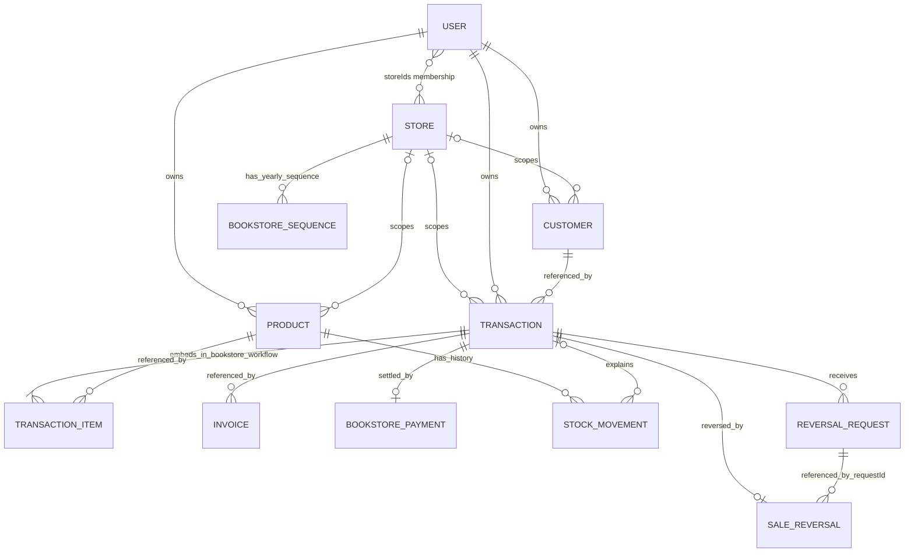

# 26.2.3 Database Relationships

The UPHSD Bookstore Point-of-Sale system connects its MongoDB documents through stored identifiers and embedded data. References associate users, stores, products, customers, transactions, invoices, payments, inventory movements, and administrative records. Embedded arrays keep transaction items and other dependent details inside their parent documents.

The relationships below were verified against the current model definitions and service code on 9 November 2026. They describe the implementation, not verified live database contents. Mongoose references do not create database-enforced foreign keys. Some links use ObjectId values or validated Mixed fields without a Mongoose `ref`; the application resolves and validates these links.

## Core relationships

In this section, one-to-many means a parent may be associated with zero or more child records. A required reference means the child must supply an identifier during schema validation; it does not establish that the referenced document exists.

| Related collections | Relationship | Linking field | Description |
| --- | --- | --- | --- |
| users and stores | Many-to-many | users.storeIds[] → stores._id | A user can hold membership in several stores, and a store can have several member accounts. Membership is stored in the user document; there is no separate membership collection. |
| users and stores | One-to-many, creator association | stores.createdBy → users._id | A user can create several stores. Creating a store does not automatically assign store membership. The field is optional in the schema but required by bookstore setup and ordering logic. |
| stores and products | One-to-many | products.storeId → stores._id | A store groups its catalog and inventory records. Historical products can lack attribution; the bookstore workflow requires valid store scope. |
| users and products | One-to-many | products.owner → users._id | Each product requires one owner identifier. Ownership is retained separately from store scope. |
| stores and customers | One-to-many | customers.storeId → stores._id | Customer records can be associated with a store. |
| users and customers | One-to-many | customers.owner → users._id | Each customer record requires an owner identifier. |
| stores and designated order customer | One selected customer per configured store | stores.orderCustomer → customers._id | The bookstore setup creates a compatibility customer named Bookstore orders. This link is not declared unique in the schema. |
| stores and transactions | One-to-many | transactions.storeId → stores._id | A store can have many pending orders and completed sales. Both use the transactions collection. |
| users and transactions | One-to-many for each user role | transactions.owner, studentUser, assignedTo, processedBy, cancelledBy → users._id | Separate fields identify the owner, submitting student, assigned cashier, processing user, and cancellation actor. Only owner is schema-required. cancelledBy is an application-resolved ObjectId. |
| customers and transactions | One-to-many | transactions.customer → customers._id | Each transaction requires a customer reference. The bookstore workflow uses the store's designated order customer. A student account is identified separately through studentUser. |
| transactions and products | Many-to-many through embedded items | transactions.items[].product → products._id | A transaction contains product lines, and a product can occur in many transactions. Each line also stores quantity, unit price, subtotal, snapshots, and an optional clothing size. |
| stores and invoices | One-to-many | invoices.storeId → stores._id | Issued invoice records are associated with the store. |
| users and invoices | One-to-many | invoices.owner → users._id | Each invoice requires an owner reference. |
| customers and invoices | One-to-many | invoices.customer → customers._id | Each invoice requires a customer reference. |
| transactions and invoices | Intended one-to-zero-or-one in the bookstore completion workflow | invoices.transaction → transactions._id | A pending order has no invoice from this workflow; successful completion creates one. The invoice schema does not declare transaction uniqueness, so its structure permits multiple invoices referencing the same sale. |
| transactions and bookstorepayments | One-to-zero-or-one, with a unique index declared | bookstorepayments.transactionId → transactions._id | Completion records one full-payment event. A unique transactionId index is declared in the payment schema. |
| stores and bookstorepayments | One-to-many | bookstorepayments.storeId → stores._id | Each payment belongs to one store. |
| users and bookstorepayments | One-to-many | bookstorepayments.actorId → users._id | Each payment records the responsible account. |
| products and stockmovements | One-to-many | stockmovements.productId → products._id | A product can have many stock adjustment, sale, and return movements. |
| transactions and stockmovements | One-to-many, optional on the movement | stockmovements.transactionId → transactions._id | Sale and return movements link to their transaction. An independent stock adjustment need not reference a transaction. |
| stores and stockmovements | One-to-many | stockmovements.storeId → stores._id | A store groups its inventory history. |
| users and stockmovements | One-to-many | stockmovements.actorId → users._id | A stock movement records the responsible account. |

## Reversal, guest-order, and numbering relationships

| Related collections | Relationship | Linking field | Description |
| --- | --- | --- | --- |
| transactions and bookstorereversalrequests | One-to-many | bookstorereversalrequests.transactionId → transactions._id | A completed sale can be referenced by multiple reversal requests; request uniqueness per sale is not declared. |
| users and bookstorereversalrequests | One-to-many for requester and approver | requestedBy, approvedBy → users._id | Each request records its requester and, when applied, the approving account. |
| transactions and bookstoresalereversals | One-to-zero-or-one, with a unique index declared | bookstoresalereversals.transactionId → transactions._id | A sale can have one applied reversal. The reversal schema declares transactionId unique. |
| bookstorereversalrequests and bookstoresalereversals | Intended one-to-zero-or-one applied result per request | bookstoresalereversals.requestId → bookstorereversalrequests._id | The service applies a pending request and marks it applied. requestId itself has no declared unique index. |
| users and bookstoresalereversals | One-to-many | bookstoresalereversals.approvedBy → users._id | An approving account can apply multiple reversals. |
| transactions and bookstoresalereversals | Optional reverse lookup | transactions.reversalId → bookstoresalereversals._id | The transaction records the applied reversal's identifier and reversal time. |
| invoices and bookstoresalereversals | Optional reference from each invoice | invoices.reversalId → bookstoresalereversals._id | The original invoice links to the applied reversal without deleting the original sale. There is no uniqueness declaration on invoices.reversalId. |
| stores and reversal records | One-to-many | bookstorereversalrequests.storeId and bookstoresalereversals.storeId → stores._id | Requests and applied reversals are scoped to their store. |
| stores and guestorderintents | One-to-many | guestorderintents.storeId → stores._id | A store can issue many private guest-order verification records. |
| guestorderintents and guest transactions | One-to-zero-or-one through a shared identifier | guestorderintents._id = transactions._id, with transactions.origin = guest | The guest submission service creates the order using the intent's _id. This is not a guestIntentId field or a Mongoose ref. An unused intent has no transaction. |
| stores and bookstoresequences | One-to-many across years | bookstoresequences.storeId → stores._id | A store has a receipt sequence for each year. The schema declares a unique storeId/year pair. Invoices do not store a sequence-record identifier. |

## Administrative and supporting relationships

| Collection | Related records and linking fields | Relationship and purpose |
| --- | --- | --- |
| bookstoreauditevents | storeId → stores; actorId → users for account actors; targetKind + targetId → the affected record | One store or actor can have many events. The target is polymorphic: targetKind identifies how targetId is interpreted. Guest events use actorKey rather than requiring a user account. |
| bookstoreoperationreceipts | storeId → stores; actorKey identifies an account or guest intent | A store and actor can have many saved command results. A unique actorKey/operationId pair identifies a replayable operation. An operation can produce multiple audit events distinguished by sequence. These are command receipts, not customer invoices. |
| accountauditevents | subjectAccountId → users; actor.id → users for account actors; optional reviewId → accountrolereviews; optional grantId → conditionalaccountgrants | One subject account can have many audit events. System-expiry events need no human actor identifier. operationId groups events from an administrative operation. |
| conditionalaccountgrants | recipientAccountId, grantedBy, optional revokedBy → users | A user can receive, issue, or revoke many grants. scope is a flexible application-defined value; it is not a universal direct Store reference. |
| accountrolereviews | targetAccountId and reviewerId → users; optional supersedes → accountrolereviews | A user can be the subject or reviewer of many reviews. supersedes connects a review revision to an earlier review. |
| accountoperationreceipts | actorId and targetId → users | An account can act on or be the target of many saved administrative operations. operationId is declared unique and correlates the result with associated audit records. |
| accountadministrationrealms | No explicit document reference | The realm revision coordinates account-administration operations. It has a String _id and is not a user/store membership record. |
| debtpayments | owner → users; customer → customers; optional transaction → transactions; storeId → stores when attributed | One customer can have many debt collections. A collection can optionally reference one transaction. This model has no separate collection of per-sale allocation links. |
| invoicecounters | owner → users | One owner can have counter records by type and year. The owner/type/year index is nonunique. The bookstore-specific sequence model uses storeId/year instead. |
| expenses | userId and optional createdBy → users | One user can have many expense entries. The model does not declare a storeId field. |
| financials | userId → users; expenses[] embedded in the financial document | A user can have multiple financial documents because userId is not unique. Embedded expense entries are distinct from documents in the expenses collection. This model is not used by the active financial reporting controller. |

## Embedded relationships

Transaction items belong to their transaction document and have no independent _id. Each item references a product while retaining name, SKU, category, price, and quantity details. This structure supports historical sale details even when catalog information changes. The current bookstore completion service rebuilds the item snapshots from the validated catalog before completing the sale.

Product.sizeStocks is an optional structure containing clothing-size quantities, not a separate collection. StockMovement.sizeChanges[] embeds the corresponding before, after, and delta quantities by size. SaleReversal.returned[] embeds the assessed returned products and quantities; the application validates them against the original transaction items. Invoice.snapshot stores issued receipt details inside the invoice.

These embedded structures are dependent data. They do not require separate collection joins and must not be shown as independently persisted collections in the database design.

## Core relationship diagram

The diagram shows the main structural links. TransactionItem represents an embedded array element. The invoice edge shows the multiplicity allowed by the current schema; the bookstore completion workflow intends one invoice per completed sale. Optional one-to-one payment and reversal edges reflect declared unique indexes, whose installation in the live database was not inspected.

The reversal-request edge also shows schema-permitted multiplicity: the service intends at most one applied result per request, but requestId has no unique index. A unique transactionId on the applied reversal limits each sale to one result when that index is installed.

## Relationship integrity

The bookstore services validate store membership and use store-scoped queries before operating on related resources. The owner, assigned cashier, processing account, student account, and customer contact serve different purposes and are not interchangeable. In particular, the designated Bookstore orders customer is not an individual student's account.

Successful bookstore completion performs the sale update, inventory movements, payment creation, invoice creation, sequence update, audit events, and command receipt within the service's MongoDB transaction boundary. An applied reversal links the request, sale, invoice, returned stock movements, and reversal event within the corresponding command transaction.

The schema declarations do not guarantee referential existence, automatic cascading deletion, or a unique invoice per transaction. These properties must be distinguished from service behavior. Existing live references, orphaned records, and installed indexes were not inspected for this documentation.

## Sources

- [Collection structures](26.2.2_COLLECTION_STRUCTURES.md)
- [User model](../backend/models/User.js), [Store model](../backend/models/Store.js), and [store attribution](../backend/models/resourceAttribution.js)
- [Product model](../backend/models/Product.js), [Customer model](../backend/models/Person.js), [Transaction model](../backend/models/Order.js), and [Invoice model](../backend/models/Invoice.js)
- [Bookstore control models](../backend/models/BookstoreControl.js) and [account control models](../backend/models/AccountControl.js)
- [DebtPayment model](../backend/models/DebtPayment.js), [InvoiceCounter model](../backend/models/InvoiceCounter.js), [Expense model](../backend/models/Expense.js), and [Financial model](../backend/models/Financial.js)
- [Bookstore setup](../backend/services/bookstoreAdministration.js), [bookstore order workflow](../backend/services/bookstoreOrders.js), [guest-order workflow](../backend/services/guestOrders.js), and [bookstore command transaction](../backend/services/bookstoreCommand.js)
