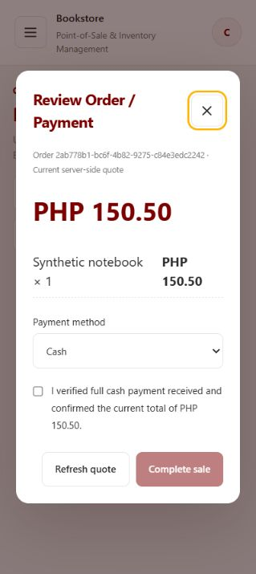
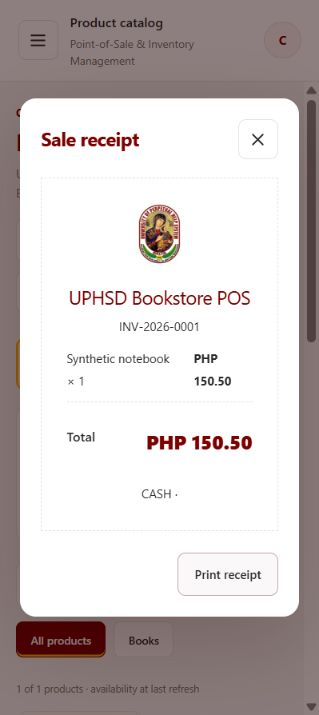

# Cashier direct checkout: actual navigation fix and verification

Verified November 6, 2026, Asia/Manila.

## Root cause found in the running application

The source files and the running backend were different versions. The disposable `tests/manualBookstoreFixture.js` process serving `127.0.0.1:5173` started on **November 4**, before the cashier direct-checkout changes in `bookstoreOrders.js`. Its backend modules remained cached in that process. The live server still returned the old order-submission response without `payment`, and its queue still admitted cashier POS drafts.

The prior client assumed that `result.payment` existed. Actual browser reproduction showed:

```text
Product Catalog -> Add to order -> Submit Order
URL remained /bookstore?view=catalog
Recorded.
TypeError: Cannot read properties of undefined (reading 'total')
  at directPaymentReview (.../directCheckout.js:4:67)
  at submitCart (.../BookstorePage.jsx:233:20)
```

The purchase was created, but no payment review opened. The stale backend exposed it through the old queue. No automatic navigation to `view=queue` occurred during this reproduction; the observed defect was a failed payment-screen transition with a queued POS draft. There is no queue redirect call in the current cashier submit handler.

A second environment mismatch was identified: two processes listened on port 5173. IPv4 `127.0.0.1:5173` served the stale disposable fixture; IPv6 `localhost:5173` served a separate Vite development process whose API configuration points to the hosted Render backend. Those are different application environments. The unrelated Vite process, its environment file, the live database server and the hosted deployment were not modified.

## Corrected flow

The cashier validates the cart, submits `POST /api/bookstore/orders`, takes the **actual `orderId` returned by the backend**, and navigates to:

```text
/bookstore?view=payment&checkout=<returned-order-id>&storeId=<selected-store-id>
```

This uses the existing `/bookstore` React route with a cashier-only payment view. That view fetches `GET /api/bookstore/orders/<returned-order-id>/quote`, then opens the existing Review Order / Payment component. It does not depend on an inline `payment` response. The order and store IDs are validated and authorized; no fabricated ID or queue selection is involved.

The payment URL survives browser refresh. Reloading performs a quote read for the same checkout and does not submit another purchase. The cashier catalog/payment views do not fetch the order queue. A quote from a stale backend that lacks the server-controlled direct-payment marker fails closed with an update/restart message; it never falls back to the queue.

The server marks cashier drafts as POS/direct-payment purchases and excludes them from the guest/student queue. The direct quote now includes the original total and a server-calculated price-change indication so reload cannot suppress changed-price confirmation. Student/guest queue quote response fields remain unchanged.

The verified stale disposable fixture was restarted using the current code. Its synthetic in-memory state was reset. A separate temporary fixture on port 5186 was used first, then stopped after verification. The original local fixture remains running on `127.0.0.1:5173`.

## Actual browser interaction verified

The corrected flow was exercised in the real browser with the repository's actual React app, HTTP routes, services and disposable in-memory transaction adapter. The page/router were not mocked during this verification.

1. Signed into the disposable cashier account.
2. Opened Product Catalog and clicked Add to order.
3. Clicked Submit Order once.
4. Observed Review Order / Payment directly, with the product, quantity, current server price, total, Cash/GCash selector and payment-verification checkbox. No queue page or order selection was used.
5. Reloaded the payment URL and observed the same checkout and public order reference, with payment verification reset.
6. Verified via live fixture API/audit reads that this checkout had exactly one submission and remained outside the queue. Separate guest and authenticated student test submissions were both present in the queue. Stock was still 10.
7. Confirmed a simulated Cash payment in the disposable fixture and clicked Complete sale. The actual browser displayed receipt `INV-2026-0001` and returned to the catalog.
8. Verified one payment event, one completed sale, one receipt, one stock movement of −1, and stock 9. A new completion attempt for the completed checkout returned HTTP 409. Guest/student orders remained queued.

The actual browser-generated checkout ID was `6aed3d835365d9b80faf9d6d`; the selected store ID was `6aed3d3d5365d9b80faf9d66`. These were observed runtime values, not implementation constants.





## Exact files changed in this fix

| File | Change |
| --- | --- |
| `client/src/features/bookstore/BookstorePage.jsx` | Cashier-only payment URL; returned-ID navigation; quote loading on navigation/reload; cart validation; explicit stale-backend handling; no queue reads during cashier catalog/payment; resume/close/completion route transitions. |
| `client/src/features/bookstore/directCheckout.js` | Honor server-reported direct-checkout price changes and original total after reload. |
| `backend/services/bookstoreOrders.js` | Add direct-payment identification and original-total/price-change metadata only to cashier direct checkout quotes. |
| `client/tests/directCheckout.test.js` | Exercise navigation/effects and responses without inline `payment`; assert actual returned ID, no queue requests, repeated-submit protection, reload/resume, stale-backend rejection, payment guards and student preservation. |
| `backend/tests/bookstoreOrders.test.js` | Test direct quote identification/repricing, repeat quote reads without new orders, and unchanged student queue quote contract. |
| `docs/CASHIER_DIRECT_CHECKOUT_FIX_VERIFICATION.md` | This verified root-cause, file, route and test report. |
| `docs/CASHIER_DIRECT_CHECKOUT_RESULTS.md` | Mark the earlier report as superseded by actual browser verification. |

No account/catalog implementation for Administrator, Store Manager, Guest Kiosk or Customer/Student was changed. No dependency, environment, routing-registration, authentication policy or database-schema file was changed. Existing queue isolation, full payment, current-price/stock validation, Cash/GCash restrictions, manual GCash verification, transaction boundaries, idempotency and exactly-once payment/stock safeguards remain in force.

## Test results

| Check | Result |
| --- | --- |
| Backend `npm test` | **848 passed, 0 failed, 0 skipped.** |
| Frontend `npm test` | **50 passed, 0 failed, 0 skipped.** |
| Frontend `npm run build` | **Passed.** Vite reports its existing large-chunk warning. |
| ESLint on changed frontend files | **Passed: no errors or warnings.** |
| Actual browser submit -> payment -> reload -> simulated Cash receipt | **Passed on `http://127.0.0.1:5173`.** Also initially verified on the temporary port 5186 fixture. |
| Live fixture queue/payment/inventory assertions | **Passed.** JSON evidence below. |

One final sandboxed frontend run encountered an infrastructure `ENOENT` while spawning Node workers. The failed log was retained, and the full suite passed with normal process access. Repository-wide lint issues in unchanged files remain documented in the earlier lint log and were outside this fix.

Added verification artifacts under `docs/cashier-direct-checkout-validation/`:

- `backend-fix-tests.txt`
- `client-fix-tests.txt`
- `client-fix-sandbox-spawn.txt`
- `fix-build.txt`
- `fix-lint.txt`
- `live-api-before-payment.json`
- `live-api-after-payment.json`
- `cashier-payment-screen.jpg`
- `cashier-cash-receipt.jpg`

## Verification boundary

The local repository application and original disposable IPv4 fixture were verified end to end in the browser. The fixture uses the real application with an in-memory database adapter; no production MongoDB data or real money was used. GCash verification safeguards were exercised by frontend/backend regression tests; no live GCash transfer was performed.

The hosted Render backend was not deployed or verified. The separate `localhost:5173` development client still targets that hosted backend. Completion is verified for the corrected source and `127.0.0.1:5173` fixture; behavior against the unchanged hosted backend remains unverified.
