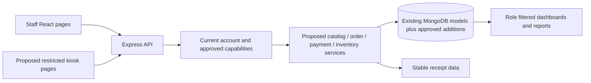

# UPHSD Bookstore POS — system blueprint

Date: 2026-11-02, Asia/Manila. Inspected baseline: commit `2e9942e` with pre-existing local lockfile changes. **Design for approval; no application implementation or database change has been authorized by this document.**

## 1. Purpose, scope and evidence

**Official system name:** UPHSD Bookstore POS. **Brand:** UPHSD Bookstore. **Institution:** University of Perpetual Help System DALTA. **Project:** Web-Based Point-of-Sale and Inventory Management System with Kiosk Ordering.

Transform the existing LadyPos / ServeFlow application. Retain useful product, cart, order, customer, invoice, expense and reporting code. Keep this repository, accounts, database, configuration and deployment independent of GradeSense AI; no integration was found in inspected application code.

The intended system centralizes the catalog, stock, kiosk orders and cashier transactions. It addresses inconsistent stock records, duplicate processing, incomplete transaction history, inaccurate reports and unclear operator permissions. These are design goals; the audit does not establish that all these problems have occurred in live operations.

Intended users are bookstore administrators, managers, cashiers, inventory staff and customers/students at a kiosk. Five separate role records are not yet approved. Existing roles are only `admin` and `user`.

Confirmed scope: catalog, inventory, kiosk ordering, centralized queue, cashier checkout, payment recording, receipt generation, sales/inventory reports, authorization and historical preservation. Excluded until separately approved: GradeSense integration, full accounting/income statement, discounts, refunds, payment gateway integration, student-record lookup, supplier procurement, multi-campus operation, offline checkout and hardware-specific integrations. Existing credit/expense functionality must be preserved until its future exposure is decided.

Existing documents already cover general ServeFlow architecture and defects. They remain unchanged. Use [prior project audit](audit/project-audit.md), [API inventory](architecture/api-design.md) and [prior verification](audit/verification-results.md) as supporting material. This seven-document set adds bookstore requirements and records checks rerun for this request. Older statements that bookstore/kiosk scope was unconfirmed are superseded by the present user request; older technical results are not automatically new test results.

### Evidence labels

| Status | Meaning |
| --- | --- |
| Implemented and verified | The named behavior was exercised successfully within the stated test boundary; not an automatic end-to-end certification |
| Implemented but unverified | Code exists; adequate runtime/business verification is absent |
| Partially implemented | Some required pieces exist, others are missing or inconsistent |
| Missing | No corresponding application implementation was found |
| Broken | Static contract contradiction or isolated execution demonstrates a failure |
| Requires further investigation | Depends on unavailable database, deployment, hardware or business evidence |

## 2. Actual technology and architecture

Versions below were checked against manifests, lockfiles and installed package metadata, not copied from README claims. The existing README is a Vite template.

| Area | Observed implementation |
| --- | --- |
| Runtime/tooling | Node 24.14.0, npm 11.9.0 in this audit environment; no declared supported runtime policy |
| Client | JavaScript ES modules, React/React DOM 19.2.4, React Router/DOM 7.13.2 |
| Build/style | Vite 8.0.3 installed/locked versus manifest `^8.0.1`; React plugin 6.0.1; Tailwind and Tailwind Vite plugin 4.2.2; custom CSS |
| Client data/UI | Axios 1.13.6, Recharts 3.8.1, react-hot-toast 2.6.0; React context and hooks |
| API | Express 5.2.1, Node ESM, dotenv 17.3.1, cors 2.8.6, express-async-handler 1.2.0 |
| Persistence | Mongoose 9.3.3 over MongoDB; live MongoDB version/topology unknown |
| Authentication | jsonwebtoken 9.0.3; bcryptjs 3.0.3 used inconsistently |
| Quality | ESLint 9.39.4; no repository-owned automated test suite or test script found |
| Declared but no direct application usage found | React Query 5.100.14, `pg` 8.20.0, dayjs 1.11.20, direct mongodb 7.1.1; Mongoose still needs MongoDB internally |

Retain the separate React client and Express backend. Browser pages call Axios adapters; Express mounts routes, invokes controllers, then Mongoose models. Business rules currently live in controllers and model hooks. Add focused services and request validation when approved; no rewrite or SQL conversion is justified. Current business scope is `owner = authenticated user`, not a shared bookstore. Separate the operator identity from approved bookstore membership before supporting several cashiers against one catalog. That is a consequential access/data migration.

The kiosk, capability layer and extracted services in this diagram are proposed. The current client calls existing controllers through authenticated endpoints.

## 3. Existing feature inventory

| Major feature | Status | Actual evidence and qualification |
| --- | --- | --- |
| Production client compilation | Implemented and verified | Vite build passed, 670 modules; not browser/API acceptance |
| Backend module loading | Implemented and verified | 38 syntax checks, 11 router imports; no DB connection |
| Login | Partially implemented | `backend/controllers/UserController.js` compares bcrypt and checks confirmation; newly registered raw passwords conflict with that path; live login not run |
| Public registration | Broken | `backend/routes/UserRoute.js`, `UserController.js:10`: public role/confirmation injection; isolated A01 confirms usable admin token |
| Password storage/change | Broken | `backend/models/User.js` has no hash hook or comparison method; A01/A02; admin reset/seed explicitly hash |
| User administration | Partially implemented | Profile admin table and admin API guards exist; public creation bypass, stale JWT roles, broken self-delete guard; search/paging hook passes options that `getUsers` adapter drops |
| Profile/settings | Broken | Auth sets `id`; handlers read `_id`; `useProfile.js` passes functional updates to a wrapper that does not support them. Theme toggle exists but UI behavior unverified |
| Product create/read/update/deactivate/search | Implemented but unverified | Product model/controller, `ProductPage.jsx`, `productApi.js`; price/SKU/category/stock/active exist; DB CRUD not run |
| Product bookstore metadata/categories | Partially implemented | Free-text category and SKU exist; ISBN, description, image and configurable threshold absent; no category master page/model |
| Inventory quantity/deduction | Partially implemented | `Product.stock`, stock patch and transaction conditional decrement exist; no movement/receiving records; absolute edits and read-modify-save adjustments race |
| Low/out-of-stock display | Partially implemented | Product/POS pages use `stock === 0` and fixed `stock < 10`; no configured threshold or inventory alert feed |
| POS/cart | Partially implemented | `PosPage.jsx` search/quantities/payment inputs exist; submit creates pending order, requires selected customer, does not complete payment |
| Orders/transaction history | Partially implemented | `OrdersPage.jsx`, `OrderController.js`; pending/completed/void; price snapshots yes, historical names/order number no; loads first 200 without full paging |
| Shared cashier queue | Missing | Existing queue lists current user's orders only; no store membership, claim or processing state |
| Customer/student kiosk | Missing | No kiosk route, public-safe catalog DTO, kiosk identity/session or kiosk submission endpoint |
| Checkout payment recording | Partially implemented | Server reads prices and conditionally deducts stock in session; client-requested paid state forces full payment without validating tender; no gateway verification |
| Debt collection/settlement | Broken | `DebtPaymentController.js`, DebtPayment save hook and order pay delegation; A05–A07 reproduce double application/full failure/wrong customer |
| Invoice issue/numbering | Partially implemented | Invoice/counter code exists; nonunique declared indexes, write-on-GET and invoice-only void risks; actual DB indexes unknown |
| Receipt/print | Broken | `Invoice.jsx:24` expects top-level items/total; API returns invoice linked to transaction. Orders invoice action only ensures record and shows toast; no reliable receipt acceptance |
| Sales dashboard/reports | Partially implemented | FinancialController aggregates mutable `amountPaid` by `createdAt`; daily/ISO weekly/monthly chart exists; not completed-time sales or payment-date collections |
| Inventory/product/category/payment reports | Missing | Current lists are reusable data/UI foundations; dedicated verified aggregates/exports are absent |
| Expenses | Implemented but unverified | Expense CRUD/page exists; hard delete and inconsistent amount validation/units; not included in dashboard calculations |
| Full financial statements/profit | Missing | Unused Financial model/FinanceChart are not accounting implementation |
| RBAC | Partially implemented | Admin user routes guarded; most business operations available to every token; no bookstore capability matrix |
| Durable audit, receiving, idempotency | Missing | No stock ledger/receipt snapshots/persistent request keys/security audit collection |
| Automated business tests | Missing | No first-party test files/test scripts; lint fails with 18 errors/13 warnings |
| Responsive/accessibility behavior | Implemented but unverified | CSS/mobile drawer/focus trap exist; no browser/device acceptance performed |
| Deployment and live DB readiness | Requires further investigation | Netlify/Apache SPA rules and CORS origin exist; fixed API port 5000; hosting, TLS, DB transactions, backups unknown |

No complete database-backed business workflow is certified working. See [test plan and current results](UPHSD_BOOKSTORE_TEST_PLAN.md).

## 4. Proposed roles and permissions — approval required

Each role must be enforced by backend capability checks and scoped queries; menus are a secondary usability control. Existing `admin/user` records must not be remapped automatically. Proposed page names below do not imply those pages exist.

| Role | Responsibilities and accessible pages | Permitted data/actions | Restricted actions/data |
| --- | --- | --- | --- |
| Administrator | Accounts, permissions, system configuration, management dashboard, catalog, inventory, queue, POS, reports, receipts | Manage approved staff membership; view bookstore operational/financial data; configure approved settings; sensitive corrections require reason/audit | No raw password/token access; no silent historical rewrite or unapproved financial removal |
| Store Manager | Operations dashboard, catalog, inventory, queue, transaction/receipt history, approved sales/payment reports | Maintain catalog/price/thresholds; oversee stock and cashier work; approve adjustments/cancellations if authorized | No role escalation, system secrets or account administration by default; refund power not implied |
| Cashier | Cashier dashboard, POS, centralized queue, own relevant history and receipts, read-only sellable catalog | Claim/process orders, record approved payment, complete once, issue/reprint permitted receipts; view retail price and available quantity | No cost price, bookstore-wide financial reports, role management, stock edits, arbitrary price changes or unapproved void/refund |
| Inventory Staff | Inventory dashboard, product reference, stock-in, movement/level reports | View counts/thresholds; record receipt of stock; request/perform approved adjustments with actor/reason/reference | No settlement, payment details, sales totals, accounts or unrestricted selling-price changes; cost access requires explicit approval |
| Customer/Student kiosk | Restricted browse/cart/order confirmation and own order reference/status | View active sellable names, retail prices and public availability; submit quantities; access only own minimal order status | No staff token, other customers' orders/PII, stock mutation, costs, financial reports, payment-status assignment or order completion |

Administrator/manager overlap on catalog and operational reporting; manager/inventory overlap on receiving and corrections; manager/cashier overlap on queue assistance. Confirm whether a manager can also sell, whether inventory staff maintain metadata, and which corrections need second-person approval. Customer is a kiosk access context, not necessarily a new User role or student account. Do not issue a general `user` token to a kiosk.

## 5. Dashboard information and calculations

All proposals below operate over authorized bookstore scope. Scope mapping awaits approval. Queries must aggregate the entire eligible dataset, not the first client page. An unavailable result must show an error/unavailable state; it must not masquerade as zero. Counts may overlap and need labels. Cost/financial fields must be omitted from unauthorized responses.

Proposed date convention for approval: store UTC timestamps, calculate calendar day/week/month in Asia/Manila, use half-open `[start, nextStart)` filters and label the period. Confirm week start, store business-day cutoff and sales recognition rules. Current code uses createdAt and no aggregation timezone.

| Management item | Proposed source and calculation | Existing support |
| --- | --- | --- |
| Total products | Count all Product records in scope, label includes inactive; separate active count | Model/list exists; dashboard aggregation missing |
| Product categories | Count distinct nonempty normalized Product.category over active catalog; confirmation needed if inactive categories should count | Free text exists; normalization/master catalog not implemented |
| Available products | Count isActive=true and sellable quantity >0 | Product fields exist; reservation policy affects formula |
| Low-stock products | Count active products with `0 < sellableQty <= lowStockThreshold`; missing threshold means unconfigured, not a guessed value | Threshold field missing; current UI fixed `<10` differs |
| Out-of-stock products | Count active products with sellableQty=0 | Stock exists; dashboard aggregate missing |
| Pending orders | Count valid, noncancelled submitted/unsettled orders in approved queue state | Current pending only, per owner |
| Completed transactions | Count valid nonvoid completed sales; label period | Current completed aggregation exists; rules need repair |
| Daily/weekly/monthly sales | Sum immutable sale total for approved completed sales by completedAt within period; separately show void/reversal amounts per approved policy | Current sum amountPaid by createdAt is unsuitable |
| Recent transactions | Latest authorized completed sale summaries by completedAt, stable number, total, state, cashier | Existing latest 10 by createdAt is reusable |
| Inventory alerts | Current low/out counts/list plus recent authorized movements and failed receiving actions where recorded | No ledger/alert implementation |

SellableQty is currently Product.stock. If reservations are approved, define on-hand, reserved and available explicitly in the database design before changing the calculation.

| Cashier item | Source/calculation and access |
| --- | --- |
| Pending orders | Authorized store pending queue count/list with number, time, item count and required total; only processing-relevant customer information |
| Orders being processed | Proposed active order claim/processing state by current cashier; store queue shows minimal claim owner to avoid collisions |
| Completed transactions | Count own `processedBy` completed nonvoid sales in approved current business day; own recent completions |
| Transaction history | Paginated permitted own sales; cross-cashier lookup scope requires approval; disclose no cost/profit |
| Daily summary | Own completed count and sum totals; payment-method collection summary only if cashier access approved; never imply full-store cash reconciliation |

| Inventory item | Source/calculation and access |
| --- | --- |
| Current levels | Product.stock per product with active state and sellable calculation; quantities only unless extra access approved |
| Low/out items | Same configured formulas as management, no duplicate hardcoded policy |
| Incoming stock records | Proposed StockMovement type stock_in, positive quantity, receivedAt, actor and delivery/reference; sum quantity by selected period |
| Recent movements | Proposed movement ledger ordered by timestamp, product, signed delta, reason, actor and linked order/receiving reference |

## 6. Product information and catalog workflow

| Field | Existing | Recommendation and justification |
| --- | --- | --- |
| Name | Required Product.name | Required customer-facing name; snapshot on sale |
| SKU/product code | Optional string, nonunique | Stable bookstore reference; confirm required/unique policy and catalog mapping before adding index |
| ISBN | Missing | Optional for books; normalize/validate only when supplied; never require for supplies or treat as sole product identity |
| Category | Free text General default | Retain initially; normalize approved vocabulary; a new Category collection is unnecessary unless managed taxonomy is approved |
| Description | Missing | Optional short text supporting kiosk identification; bounded plain text |
| Selling price | Product.price, Number min0 | Retain; propose safe integer PHP centavos after historical-unit review; server authoritative |
| Cost price | costPrice default0 | Preserve existing values; optional/restricted; default zero is unknown cost, not proof of free stock; no profit calculation from it |
| Current stock | Product.stock min0 | Authoritative on-hand quantity; integer validation; changes through audited inventory commands |
| Low-stock threshold | Missing | Product-specific nonnegative integer, management-approved default or explicit unconfigured state |
| Product image | Missing | Optional kiosk aid; no mandatory upload/storage service until authorized; accessible placeholder for absent image |
| Availability | isActive plus stock | Derive availability; inactive is not the same as out of stock; avoid independently editable duplicate available flag |
| Timestamps | createdAt/updatedAt | Retain; track actor and reason on significant changes |

Proposed categories, **not an approved live catalog:** textbooks, reference books, school supplies, notebooks, writing materials, uniforms, laboratory materials and school merchandise. Uniform sizes/variants and specialized lab items require catalog confirmation before variant schema work.

Authorized staff create/validate catalog records, search by name/SKU/ISBN when added, update metadata without rewriting omitted fields or stock, and deactivate instead of deleting products referenced by sales. Current update payload supplies defaults and can overwrite omitted stock/cost fields; repair before reuse. Kiosk displays only approved active/sellable products with retail information. Revalidate on order submission and checkout because displayed stock can become stale. Barcode/scanner text search is not a verified scanner integration.

## 7. Inventory information and authority

Retain **Product.stock as the authoritative current on-hand quantity**. Do not create another mutable inventory total collection. Proposed StockMovement records explain changes; they are an append-only ledger committed with the corresponding Product increment/decrement. Reports reconcile opening balance + signed movements to Product.stock.

Each movement needs product ID, approved bookstore scope, signed integer quantity, type (opening, stock_in, sale, adjustment, reversal as approved), reason, responsible authenticated user, recorded timestamp, optional effective receivedAt, and source transaction/delivery/request reference. Reject changes leading below zero; do not silently clamp or truncate. Receiving and manual corrections need distinct reasons and approval rules. Current stock edits have no durable movement/actor trail.

Historical quantities remain untouched during audit. A later approved migration can record an explicitly dated opening balance from reconciled current stock. It cannot fabricate historical receiving/sale movements. Receiving records describe stock actually received; purchase orders, suppliers and expected deliveries are outside confirmed scope.

Deduct stock at the approved settlement point exactly once, with sale/payment/invoice/idempotency writes in one supported database transaction. Current code deducts on completion even for debt/partial sales; payment validation and deduction timing are unresolved bookstore rules. If inventory reservations are approved, design their authoritative representation, expiry/release and allocation checks first. Do not infer that pending orders reserve stock; current code does not reserve it and does not test stock quantity on pending submission.

## 8. Orders, states and transaction information

Current Order.js registers a **Transaction** in `transactions`; both `/orders` and `/transactions` refer to it. Retain that internal model/collection and route compatibility. A separate new Order collection is not justified solely by branding.

Proposed record contents: unique durable order number; createdAt; source kiosk/POS; scope; item product IDs plus name/SKU/category snapshots where needed; recorded integer unit prices; positive integer quantities; line subtotals; total; independent order/payment state; processing cashier and timestamps; cancellation actor/time/reason; stable request key and receipt/transaction references. Customer identity is optional unless a confirmed credit/pickup policy requires it. Do not require student IDs or collect unnecessary personal information.

Existing items snapshot unitPrice/subtotal but not product name/category; current UI populates today's product name. Current `_id` is a unique document key, not an approved customer-readable queue number. Invoice numbering happens later and is not a kiosk order number. Propose retaining `_id` and adding an indexed unique bookstore-scoped orderNumber with collision-safe generation; format, reset period and uniqueness scope require approval.

### Candidate state design — not approved

| State | Entry/action | Exit and safeguards |
| --- | --- | --- |
| Draft cart | Client session only | Submit once after server validation; not yet an order |
| Pending | Server accepts an order and number | Authorized cashier claims/processes or cancels; reservation effect is undecided |
| Processing | Optional claim state with actor/version/expiry | Complete after payment, release claim or cancel per approved policy |
| Completed | Settlement has passed approved validation | Immutable sale; any return/void requires separately approved reversal policy |
| Cancelled | Unsettled order cancelled with actor/reason/time | Terminal; release reservations if any; no financial/stock reversal for an order that never had those effects |
| Ready/Collected | Optional pickup/fulfilment states | Introduce only if pickup is required; keep fulfilment distinct from paid sale where necessary |

Current states are pending/completed/void, and payment states paid/partial/debt. Propose payment unpaid/paid for a simple full-payment bookstore workflow **only if approved**. If credit/partial payments remain, retain their semantics and add reliable payment events/allocations. Do not migrate old values or conflate cancellation with a paid-sale void.

Persistent idempotency must bind scope, action, key and normalized request hash. Replaying the same request returns its prior committed result; conflicting reuse rejects. Unique order/invoice/counter constraints must protect races. Completion uses a conditional state/version transition and atomic inventory updates. A UI disabled button is insufficient. Expired claims must not reopen settled orders; idempotency retention must not permit an old financial effect to execute again.

## 9. Payments and settlement

Proposed transaction view includes unique transaction number (potentially the completed order number plus receipt reference if approved), linked order, cashier, settlement timestamp, immutable sold items/prices, subtotal/total, approved discount only if introduced, payment method, validated amount applied, tendered amount/change when relevant, status and receipt reference. Stable numbering must not relabel historical issued invoices.

Existing methods are cash/gcash/bank/credit. They are code values, **not confirmed bookstore acceptance rules**; there is no external processor integration. A typed reference is not independent proof of electronic payment. Confirm permitted methods, manual verification and evidence, credit/partial policy, cash tender/change and who can settle or reverse.

Server derives every total and checks finite safe integer amounts and quantities, legitimate transitions and authorized scope. For approved cash tender T and total S, payment applied=S and change=T-S only when T>=S; retain tender separately. Electronic amount must match the approved rule and carry required verified evidence. Client-submitted paymentStatus cannot assert receipt of funds. Current completion code converts requested paid status into full amount automatically; it does not establish payment validation.

Initial payment events and any later collection events must not be counted twice. Existing linked debt mutation must be repaired before reuse. Discounts, taxes, refunds, accounting postings and installment policy are unresolved; no rules are invented here.

## 10. Receipt information

Proposed receipt: UPHSD Bookstore text branding; official system name where appropriate; stable receipt/transaction/order references; full date/time with business timezone; item names, quantities, unit prices and subtotals; subtotal and total; approved payment method, tender, applied amount and change where applicable; cashier reference; status/reprint indication as appropriate.

Receipt data comes from immutable completed-sale/issue snapshots, not the cashier's personal profile or current product catalog. Generate/retrieve it after successful commit. A printer failure permits reprint of the same receipt without repeating settlement or issuing a second number.

Management must supply authorized official logo/color guidelines if desired, receipt header/address/contact details, any applicable registration/tax/receipt wording, approved numbering and printer/paper requirements. Do not represent a provisional system printout as a certified statutory receipt. Current seven-day invoice dueDate is an existing credit assumption, not an approved bookstore rule.

## 11. Proposed kiosk workflow

1. Customer browses a restricted available-product catalog.
2. Selects products.
3. Selects quantities within displayed limits.
4. Reviews cart and server-confirmed retail totals.
5. Server validates active product, quantity, current price and availability.
6. Customer confirms; a stable request key prevents repeat submission.
7. Server commits the order and unique order number.
8. Order appears in the authorized centralized queue.
9. Cashier retrieves/claims it under approved processing rules.
10. Approved payment is recorded and validated.
11. Transaction completes only after successful payment validation.
12. Receipt becomes available from the committed result.
13. Inventory reflects that sale safely and exactly once.

Steps 10–13 describe customer-visible results. The inventory effect and settlement records must commit atomically before a successful completion/receipt response; stock deduction must not be deferred to an unreliable print operation. If reservations/pickup change this timing, their policy requires explicit approval.

This workflow is proposed; no kiosk-specific implementation exists. Required confirmations: customer-facing versus staff-operated kiosk; payment at cashier versus another approved point; pickup requirement; necessary order/fulfilment states; reservation before payment and expiry/cancellation handling. The kiosk must use a dedicated restricted API context, reset abandoned sessions/cart data, prevent access to another customer's details and recover from timeouts without duplicate orders. Offline sale acceptance is not in confirmed scope.

## 12. Cashier POS and simultaneous work

Retain existing search, product cards, quantities and cart components where suitable. Cashier searches the shared authorized catalog, selects active products, adjusts/removes lines, reviews prices and available stock, checks out or retrieves a pending order, records approved payment, completes once, obtains receipt and searches permitted transaction history.

Server revalidates current availability and the approved price-lock/repricing policy; never accepts cart unit prices as authoritative. Current pending items keep their stored prices during completion and are not rechecked for active status; approve how deactivation/price changes affect queued orders.

Separate cashiers use distinct authenticated identities and shared approved store scope. Conditional per-product decrement with sufficient-stock predicate plus a multi-document transaction prevents partial multi-item sales. Conditional order claims/state transitions, version checks and persistent idempotency prevent double settlement. Handle transient transaction conflicts with bounded safe retries; ambiguous commit must resolve via durable result lookup, not create another sale. Prove the final-item race on a disposable transaction-capable database. Current session use alone is not adequate evidence.

## 13. Reports, sources and permissions

All reports need server-side date/scope validation, pagination for details, inclusive UI dates converted to half-open timestamp boundaries, explicit timezone/basis, stable totals independent of pagination and authorized projections. Proposed default readers: administrator/manager. Inventory staff receive quantity/movement reports only. Cashier sees permitted own transaction/collection summaries, not store-wide sales/costs. Kiosk receives none.

| Report | Calculation/database source | Filters | Existing status |
| --- | --- | --- | --- |
| Daily sales | Sum nonvoid eligible completed Transaction.totalAmount by completedAt local day, plus count; reversals separately per approved policy | Date, cashier, source; store scope always enforced | Existing chart uses different basis; modify |
| Weekly sales | Same sale basis grouped by approved local week start | Week/date range, cashier | Partial ISO week chart; no timezone |
| Monthly sales | Same by local calendar month | Month/date range, cashier | Partial chart; same defects |
| Sales by product | Unwind immutable sale items, group product ID, sum qty/subtotal | Period, product/category, cashier | Missing |
| Sales by category | Sum sale-item subtotal/qty grouped snapshot category; confirm category-at-sale versus current classification | Period, category | Missing snapshots/report |
| Completed history | Paginated immutable completed sales with references, totals, cashier, payment state; cancellation/void history separately authorized | Completion range, order/receipt reference, cashier, method, status | Reuse orders list; incomplete filtering/paging |
| Inventory levels | Current Product.stock with active/threshold/sellable status | Name/SKU/ISBN if added, category, availability | Product list foundation; no certified report |
| Low stock | Active products with 0<sellable<=configured threshold | Category, product, threshold state | Fixed UI threshold only |
| Out of stock | Active products with sellable=0 | Category, product | List badges only |
| Incoming stock | Positive StockMovement.stock_in records and quantities; not currency spent | Received/recorded date, product, actor, delivery/reference | Missing |
| Movement history | Signed quantity ledger with source, before/after where useful; opening+sum(delta)=current at reconciliation point | Product, type, date, actor, source | Missing |
| Payment summary | Sum immutable initial/later applied payment events by actual paidAt and method; tender/change separate; reversals per policy | Payment date, method, cashier, reference, state | Missing reliable event history; current mutable sale sums unsuitable |

Revenue is not profit. No gross margin or net income is approved. A later margin report requires reliable historical cost snapshots and an approved valuation policy; an income statement additionally requires accounting scope beyond this project. Expense CRUD does not establish that system.

## 14. Branding and delivery boundaries

After explicit phase approval, use provisional **text-based UPHSD Bookstore** identity and restrained neutral colors. Reuse existing layout, forms, cards, typography and mobile behavior where sound. Do not invent an institutional emblem or claim current teal/blue colors are official.

Review login/register, sidebar/header/navigation, account/dashboard, products/inventory, POS/queue, future kiosk, invoices/receipts, expenses/reports, toast/error/empty/loading text, browser title/favicon/assets, documentation and actual hosting display names. Primary source locations: `client/index.html`, `client/public/serveflow.*`, auth pages, Layout.jsx, LoadingScreen.jsx, Invoice.jsx, index.css and `backend/index.js` CORS/deployment references. Legacy food-service loading messages and Grab/Foodpanda options need an approved compatibility treatment; do not destroy historical values.

No internal model, collection, API, environment variable, checkout folder or package identifier needs renaming merely for branding. Any technically necessary future naming change must have a compatibility/migration note. No application branding has changed in this audit.

Read [requirements confirmation](UPHSD_BOOKSTORE_REQUIREMENTS_CONFIRMATION.md) before authorizing an implementation phase.
