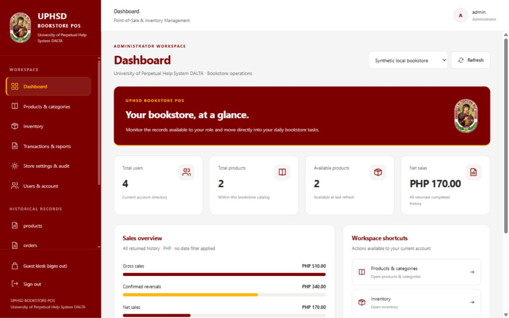
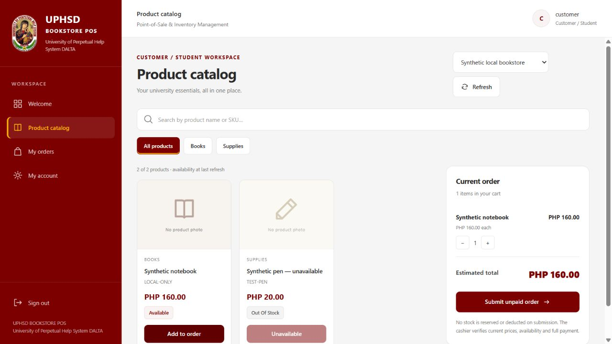
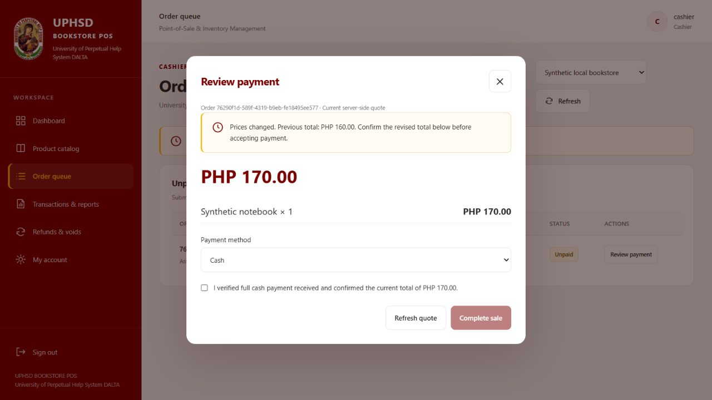
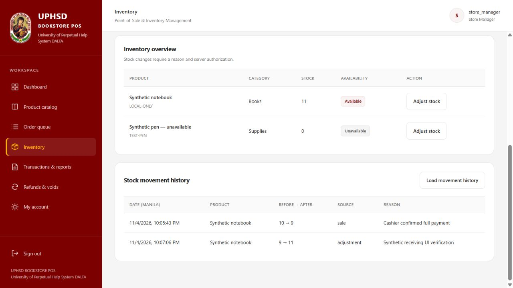
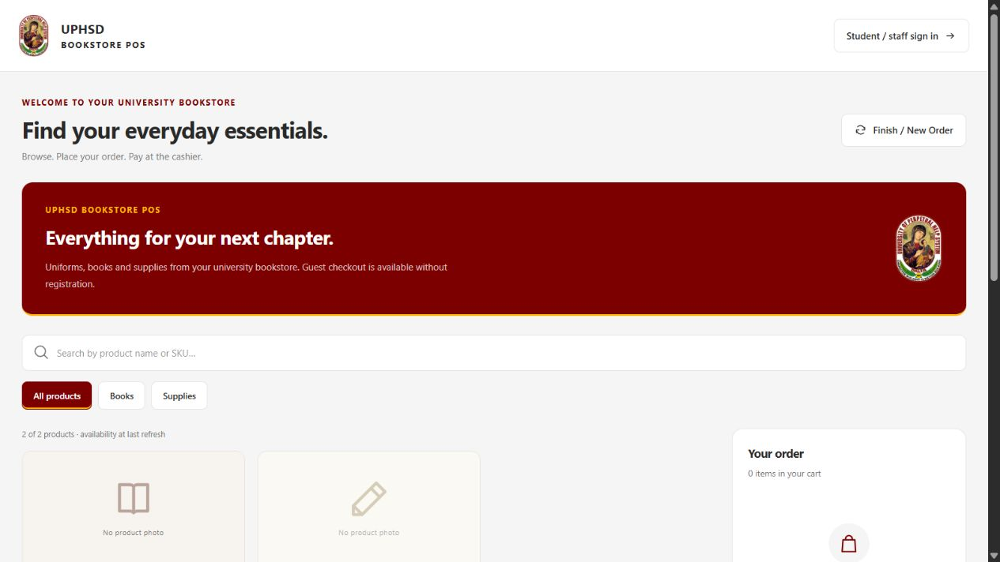

# UPHSD Bookstore POS — UI redesign results

Date: 2026-11-04, Asia/Manila.

## Scope and disposition

The existing React 19 / Vite 8 / Tailwind 4 frontend has been redesigned in place. React Router paths, Axios integrations, B01/B02 authentication and account lifecycle, B03 command identities/reconciliation, guest session machinery and server contracts remain in use. There is no replacement application, new dependency, database migration, backend correction or deployment.

**Local UI implementation and verification completed within existing capabilities. Production activation remains NOT READY. AR01 remains unresolved.** This report does not supersede the activation audit or historical B01/B02/B03 acceptance limitations.

The checkout, inventory, refund and authorization code in the backend was not edited. A before/after SHA-256 comparison of all 117 backend first-party files, including source, tests, configuration and manifests but excluding node_modules, found zero additions, deletions or content changes. Existing dirty/untracked repository work was retained.

## Inspection and implementation plan

Inspected App routes, Layout, global styles, the bookstore context/capability/navigation modules, operational BookstorePage, kiosk/session/private proof handling, authentication/account components, current product DTOs and bookstore routes/read/command services. Reviewed the activation audit and implementation roadmap.

The existing component system consists of Tailwind utilities and local React components. B03's operational UI was a single long page; account lifecycle tools were already in Profile. No product-image, general settings, category CRUD, date-filtered reporting/export or GCash QR configuration endpoint exists in the current operational contract.

Implemented the following plan:

1. Establish exact brand tokens and copy the supplied official seal unchanged.
2. Replace the shell with responsive, permission-aware university navigation and consistent page framing.
3. Split the existing operational page into role-specific query-selected views, retaining its commands and URLs.
4. Add catalog cards, details, filters, cart, tables, audit/reversal/payment dialogs and accurate empty/loading/unavailable states.
5. Apply branding to login, account, registration information and receipts; preserve existing account lifecycle components.
6. Verify using existing regressions, guarded in-memory API tests and browser walkthroughs; document unavailable capabilities and activation blockers.

## Design system and logo

| Token / treatment | Value |
| --- | --- |
| Primary maroon | `#7C0000` |
| Accent gold | `#FFB603` |
| White surface | `#FFFFFF` |
| Page background | `#F5F5F5` |
| Text | `#292929` |
| Muted text | `#777777` |
| Border | `#E5E5E5` |
| Typography | Inter when installed, Segoe UI, system sans-serif; no external font request |
| Spacing / cards | 4px base unit; consistent 8–32px spacing; 14px card token |

Maroon anchors the sidebar, headings, buttons and brand areas. Gold marks active navigation and restrained accent lines. Content remains white on light gray. Saved dark-theme attributes cannot restore unrelated previous colors; the shell uses the official light presentation.

Source: the user-supplied `C:/Users/jmley/Downloads/University_of_Perpetual_Help_System_DALTA_logo.png`. Copied byte-for-byte to `client/public/uphsd-seal.png`. Both SHA-256 values are `E3E13CC8A09716AFEF2DAF3DD58E2EFDD7A54BF2991265B78C88A6F094F2DAAA`.

The seal is used on login, sidebar, kiosk, dashboard, receipts and favicon. Images use `object-fit: contain`, preserving the complete original seal, aspect ratio and colors. It was not cropped, recolored or regenerated. Product illustration placeholders are explicitly labeled “No product photo”; they are not represented as photographs of actual stock.

## Pages and role-specific changes

Existing paths remain: `/login`, `/register`, `/kiosk`, `/bookstore`, `/profile` and historical routes. Bookstore views use `/bookstore?view=...`, with browser history navigation. Missing or unauthorized view selections fall back to the authorized overview. The existing `/pos` redirect is retained.

| Interface | Redesigned experience |
| --- | --- |
| Administrator (`admin`) | Dashboard with API user count, catalog count, availability and returned sales summaries; products/categories; admin-only pricing; product creation/archive; inventory overview/movements; all cashier history; store administration, memberships and audit. Existing user provisioning, role assignment, confirmation and account management remain under Users & account. Unsupported general/QR settings are explicitly unavailable. |
| Store Manager (`store_manager`) | Operations dashboard; catalog/availability; unpaid queue monitoring; reason-required stock adjustments and movement ledger; all authorized cashier history; refund/void request review; original-method repayment confirmation and assessed saleable returns. Cancellation is disabled under AR01. No pricing control is shown. |
| Cashier (`cashier`) | Catalog/search/categories/details; cart; unpaid queue and self-claim; server quote review; changed-price notice; full cash or manually verified GCash payment; reference entry; completion and receipt; own history and reversal requests. No account, pricing, stock adjustment, repayment approval or cancellation controls. |
| Customer / Student (`customer`) | University welcome, catalog cards/details, category/search filters, unavailable stock states, order cart/submission and owned order status. Existing authenticated account checkout remains available. |
| Guest | Standalone branded kiosk, no registration requirement, catalog/search/categories/details/cart, unpaid submission and public reference, private tracking file download and masked tracking inputs. Finish/New Order and reload clearing verified. |
| Legacy / historical | Existing read-only boundaries, routes and content retained under the shared palette, navigation, forms and table styling. No historical transaction or legacy account conversion was introduced. |

Categories and product types come from actual catalog responses. No uniforms, books, PE clothing, stationery, subjects or metrics were fabricated. Product cards show name, SKU, category, price and available status. Additional descriptions and product photos are unavailable in the current DTO.

## Shared components and behavior

`BookstoreUI.jsx` supplies Brand, Icon, Panel, EmptyState, Notice, StatCard, CatalogFilters, ProductVisual, ProductDetails and Modal. Dialogs include focus containment, Escape handling, focus restoration, busy feedback and disabled dispatch states. The shell includes a skip link, current navigation state, mobile drawer, resize handling, one sidebar scroll region and main-content scroll reset on navigation.

`presentation.js` supplies canonical display labels, category/search intersection, capability-derived view definitions and the explicit AR01 blocker explanation. This presentation layer does not grant server permissions.

The existing operational command dispatcher still retains nonsecret, account-bound operation identities before dispatch. Indeterminate results block replacements until reconciliation. No payment, inventory or refund success is generated locally.

## API integrations and workflow preservation

| Existing integration | Presentation use |
| --- | --- |
| `GET /bookstore/context` | Current role, membership and capability/resource bounds |
| `GET /products` | Catalog, availability, stock where disclosed; fetch all declared pages, rather than presenting the first 100 as the whole catalog |
| Product create/update/archive/stock endpoints | Existing audited commands; admin-only price UI, Manager adjustment UI |
| `GET /users`, existing account APIs | Real total user count, existing account lifecycle UI and explicit membership selection |
| Bookstore store/membership commands | Retained administrative setup commands and expected account version |
| Order submit/own/queue/claim/quote/complete endpoints | Unpaid submission, assigned checkout, current server prices and full verified payment |
| Transactions/reversals/receipts | Authorized own/all history, real summaries, whole-sale request/apply and issued receipts |
| Movements/audit/operations | Real ledger, operational events and acknowledgment reconciliation |
| Guest catalog/intents/orders/tracking | Memory-only session; credential header, separate public reference and private proof |

Submission remains unpaid and does not reserve stock. Completion uses the current quote/digest and confirmed total; price changes are displayed and the cashier must explicitly confirm full payment. Only cash and GCash are offered. GCash requires a reference and manual account verification; no screenshot upload or automatic payment-success path exists.

Reversals still use the original payment method and whole-sale amount. A Manager confirms repayment and saleable return quantities; GCash requires a refund reference. The POS records confirmation without initiating a transfer. Backend duplicate-reversal/idempotency and immutable history logic remain unchanged.

Guest credential lifetime remains seven days from server issuance. The existing five-minute memory-only session, late-response protection and page lifecycle cleanup remain unchanged. Plaintext credentials are no longer printed on the shared kiosk screen. An explicitly selected download retains the private credential in a confidential JSON file; it is not stored in localStorage/sessionStorage, tracking URLs, screenshots or diagnostics. Saved access continues to work after the kiosk is cleared. A physical shared-kiosk handoff/secure handling of the downloaded file remains an operational limitation; this redesign does not implement a mobile delivery service.

## AR01 and unsupported capabilities

**AR01 remains a separate high-severity activation blocker.** The activation audit reproduced conditional Administrator unpaid cancellation without a Manager actor. This task did not repair or reverify that backend boundary. The frontend sends no cancellation command. Manager queue entries show a disabled “Cancellation blocked · AR01” control and an explanation. Administrator cancellation controls are absent. Frontend suppression does not resolve server authorization.

The UI also intentionally limits stock adjustment and repayment approval controls to Store Manager as requested. Existing backend conditional-grant exceptions are unchanged; their presence is not a new UI authorization or a claim of remediation.

Other limits:

- Product photographs, extended descriptions, separate category CRUD, general settings and configured GCash QR retrieval are absent from the current API; no substitute data or simulated operation was added.
- Reports show all returned history and label its scope. Date-range reports and export are unavailable; no invented time series is displayed.
- Membership selection loads the first 100 accounts and discloses that limit. Full account search/paging remains in the existing account-management table.
- Store creation, membership application, account lifecycle mutations, every historical page, native MongoDB concurrency/recovery, physical printing, full accessibility certification and deployment behavior were not exhaustively browser-tested here. Existing regression passes have their staged limitations.
- All activation-audit blockers AR01–AR08 remain open unless closed through separately approved work. No production readiness claim follows from this report.

## Executed verification

All browser/API work used `client/tests/uiBrowserFixture.mjs`, derived from the existing B03 disposable fixture. It uses actual application routes/services with the staged in-memory adapter, four synthetic canonical accounts and synthetic products. No native database is connected. Vite environment-file loading is disabled and the API is forced through the localhost proxy. `uiApiSmoke.mjs` refuses to run without the explicit fixture guard and matching fixture identity endpoint.

| Check | Result |
| --- | --- |
| Frontend `npm test` | **32 passed**, 0 failed/skipped/cancelled; previous 26 regressions plus six role-navigation/catalog cases |
| Backend `npm test` | **812 passed**, 0 failed/skipped/cancelled; existing suite, backend untouched |
| Additional guarded localhost API smoke | **5 groups passed**: four matching role contexts; seven backend denials; unchanged stock on unpaid submission; unverified payment rejection without deduction; confirmed completion/replay with one sale, one deduction and identical receipt |
| Current role UI (nine JS/JSX source files) and presentation-test lint | **PASS**, no findings |
| Two manual fixture/smoke harness syntax checks | **PASS** |
| Full client lint | **FAIL**, 13 inherited errors / 12 warnings; before redesign: 15 errors / 12 warnings |
| Production build | **PASS**, 680 modules; main JS 801.16kB (gzip 241.80kB), CSS 55.39kB; existing >500kB chunk warning remains |
| Backend preservation | **117/117** first-party files identical; zero changes/additions/deletions |

Browser walkthroughs verified:

- All four role logins/navigation and role-specific action visibility.
- Administrator product creation (zero starting stock), price updates, unmatched search/empty state, account listing and account dialog opening/cancellation, membership account loading and audit ledger retrieval. No account lifecycle mutation was performed through the browser.
- Student cart and authenticated unpaid submission; unavailable product cannot be added.
- Cashier claim, server price revision from PHP160 to PHP170, disabled unconfirmed completion, full cash completion and generated receipt; own history.
- GCash completion disabled without reference or verification, and re-confirmation required after reference editing; confirmed synthetic completion and reference-bearing receipt.
- Manager inventory adjustment/movement ledger, all cashier history, whole-sale cash reversal with saleable return assessment, GCash reversal locked without refund reference, and completed Manager confirmation. Applied requests no longer offer approval.
- Guest unpaid submission/public reference; private credential absent from visible output; tracking download; Finish/New Order reset; saved credential still retrieves reference/status; reload clears the active cart/proof.
- Desktop, 834×1112 tablet and 390×844 mobile layouts; mobile drawer and desktop resize; navigation scroll reset. Screenshots record representative states, not every possible device.

The approved five-minute and seven-day boundaries are covered by existing controlled-clock module/backend tests; no seven-day real-time or five-minute browser-idle wait is claimed. Receipt generation and receipt viewing were exercised; physical print output was not.

Initial sandbox attempts produced Windows EPERM child-process and EACCES localhost failures. Reruns outside those restrictions passed. The first smoke harness expected HTTP201 for order submission; the existing contract is HTTP200. The harness expectation was corrected and final runs passed without changing the API. The first preview port was already occupied and was left untouched; the isolated preview used 5186. An in-app connection timeout was resolved by running that fixture outside sandbox network isolation; native browser approval timed out, so final browser testing used the in-app browser.

Full lint findings remain in unchanged account modal/profile/security components, historical order/people/product components/pages, AuthContext and useServerReady. The redesigned Layout removed its two baseline set-state-in-effect errors. No lint suppression or account lifecycle rewrite was introduced.

Evidence logs: [frontend tests](ui-redesign/validation/client-tests.txt), [backend tests](ui-redesign/validation/backend-tests.txt), [API smoke](ui-redesign/validation/api-smoke.txt), [build](ui-redesign/validation/build.txt), [baseline lint](ui-redesign/validation/lint-before.txt), [final lint](ui-redesign/validation/lint.txt).

## Files authored or updated in this task

| File | Purpose |
| --- | --- |
| `client/public/uphsd-seal.png` | Supplied official seal, unchanged |
| `client/index.html` | Official favicon; remove external previous font |
| `client/src/index.css` | Brand tokens, responsive shell/catalog/dialog/table/forms, inherited component styling |
| `client/src/shared/components/BookstoreUI.jsx` | Shared branded presentation components |
| `client/src/shared/components/Layout.jsx` | Role navigation, desktop/mobile shell, scroll/focus behavior |
| `client/src/features/bookstore/BookstorePage.jsx` | Focused operational views and dialogs using existing commands |
| `client/src/features/bookstore/presentation.js` | Labels, capability-derived views, filters, AR01 explanation |
| `client/src/features/kiosk/KioskPage.jsx` | Catalog/cart welcome, private tracking retention and reset presentation |
| `client/src/features/auth/pages/LoginPage.jsx` | Branded sign-in and guest entry; recoverable login error presentation |
| `client/src/features/auth/pages/RegisterPage.jsx` | Honest managed-account information in place of an unconnected public registration form |
| `client/src/features/auth/pages/ProfilePage.jsx` | Branded account framing; existing lifecycle components retained |
| `client/src/features/invoices/components/Invoice.jsx` | Official seal on the existing historical receipt |
| `client/src/features/financials/components/FinanceChart.jsx` | Brand/neutral series colors only; historical metrics and interactions unchanged |
| `client/src/features/financials/pages/ExpensePage.jsx`, `client/src/features/products/components/ProductCard.jsx`, `client/src/features/orders/components/UpdateOrderModal.jsx`, `client/src/features/people/components/PersonCard.jsx` | Replace remaining hardcoded historical status/action colors with shared tokens; behavior unchanged |
| `client/tests/presentation.test.js` | Role/view boundaries and catalog filtering regression cases |
| `client/tests/uiBrowserFixture.mjs` | Explicit disposable browser/API test host |
| `client/tests/uiApiSmoke.mjs` | Guarded real-route API smoke assertions |
| This report, `docs/UPHSD_BOOKSTORE_IMPLEMENTATION_PLAN.md`, `docs/implementation/implementation-roadmap.md` | Results and additive roadmap history |
| `docs/ui-redesign/` | Screenshots and validation logs |

No backend file, database schema, migration, production record, dependency manifest, lockfile, account lifecycle hook or historical completion report was changed by this task. Build output is local only.

## Screenshots

All screenshots show disposable synthetic data. Earlier workflow captures precede minor final typography/sidebar refinements; the Administrator capture shows the final desktop shell. No private guest credential is included.







Additional captures: [login](ui-redesign/login.jpg), [GCash verification](ui-redesign/gcash-verification.jpg), [AR01 blocker](ui-redesign/ar01-blocker.jpg), [tablet kiosk](ui-redesign/kiosk-tablet.jpg), [mobile navigation](ui-redesign/mobile-navigation.jpg).

## Local reproduction

From the repository root, use installed dependencies:

```powershell
npm --prefix client test
npm --prefix backend test
npm --prefix client run build
$env:B03_FIXTURE_ONLY = '1'
node client/tests/uiBrowserFixture.mjs
# In a second terminal, with the same explicit fixture guard:
$env:B03_FIXTURE_ONLY = '1'
node client/tests/uiApiSmoke.mjs
```

The fixture serves only `http://127.0.0.1:5186`, uses ephemeral backend localhost routing, and loses all synthetic state when stopped. It never starts `backend/index.js`. Browser fixture processes started for verification are stopped after testing. No production or native database execution is authorized by these reproduction instructions.

