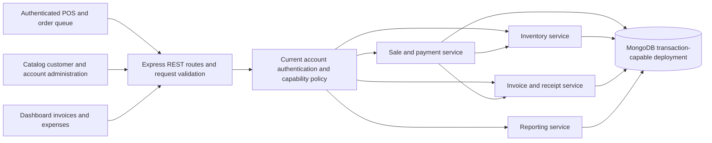

# Recommended architecture

Status: **proposal; not implemented by this audit**. Retain the actual React/Vite, Express and MongoDB/Mongoose stack. This is a small modular monolith with one API deployment and one database; no microservices, message broker, separate accounting platform or PostgreSQL replacement is justified.

## Current system and intended boundary

The SPA contains operator POS, pending orders, catalog, customers, invoices, expenses, dashboard and account administration. Express exposes REST; Mongoose persists nine model types. Business rules currently live in both controllers and model hooks. `owner` normally equals the authenticated account ID. Code proves an operator queue but does not establish a public kiosk or an online shop.

## Proposed system diagram

The diagram shows the recommended supported operator system. Kiosk/device access, suppliers, gateways and full accounting are excluded until requirements justify them. Fonts are a browser asset dependency, not an API integration.

## Responsibilities

| Component | Responsibility | Boundary |
| --- | --- | --- |
| React pages/components | Cart interaction, money formatting, accessible inputs, loading/error states, print preview | Never determine authoritative price, stock, permissions or accepted payment totals |
| Feature API adapters | Typed-by-contract request/response mapping, auth failure recovery, pagination | One consistent envelope; preserve request keys across retries |
| Routes/controllers | Authenticate/authorize, validate DTO, invoke one service, translate result/error | No requests delegated into another controller; no business mutations hidden in serializers |
| Account service/policy | Password hashing/comparison, provisioning, confirmation and current-session validity | Canonical user.id; only approved role/status transitions |
| Sales/payment service | State transitions, authoritative item snapshots, money/credit rules, idempotency, allocations | Owns transaction session; orchestrates inventory, payment and invoice writes |
| Inventory service | Atomic guarded increments/decrements, availability, adjustment reasons and movements | Same session as sale/void; metadata edits cannot replace stock |
| Invoice/receipt service | Scoped unique number, one invoice per sale, immutable receipt DTO and reprint | Issue only in approved state; GET does not issue or void |
| Reporting service | Explicit sales/collections/outstanding/expense definitions and timezone | Reads authoritative events/snapshots; does not repair records on read |
| Mongoose schemas | Field types, required/enums, integer/bounds validation, indexes and relationships | Derived validation may remain pure; payment/invoice side effects move into services |
| MongoDB | Atomic writes and multi-document commit, unique constraints, persistence and recovery | App validates owner relationships; foreign key references are not enforced by MongoDB |

No generic repository abstraction is needed initially: service functions can use the existing Mongoose models directly. Keep the existing Express entry point; extract testable app construction only when implementing meaningful API tests, preserving one listener and startup path.

## Identity and access

Baseline: admin provisions accounts as supported by login UI; every protected action loads current account state and verifies capability/owner scope. Keep existing admin/user role vocabulary while documenting its mapping. Separate authorization decisions from UI visibility. Resolve whether account owners are independent businesses or operators in one store before shared inventory work. A Store/membership model is conditional, not an implicit migration.

Keep the present bearer approach during urgent repairs, with explicit expiry, account/session invalidation and frontend401 handling. A later cookie change is optional and requires CSRF/CORS review. Passwords use the existing bcrypt dependency through one tested write/comparison path; no plaintext or accidental double hashing.

## Transaction and error boundary

Create/complete sale, stock movement, invoice issue and idempotency completion must commit together. Payment event, allocations, sale balances and invoice status must commit together. Void effects must be one approved atomic transition; it is not automatically a refund. Use a transaction-capable MongoDB test environment and a supported retry strategy; an aborted attempt must not emit a durable success event. [MongoDB transaction documentation](https://www.mongodb.com/docs/manual/core/transactions/) describes atomic multi-document commit.

Use stable domain codes such as VALIDATION_FAILED, FORBIDDEN, NOT_FOUND, INSUFFICIENT_STOCK, INVALID_STATE and IDEMPOTENCY_CONFLICT. Map them once to400/422,403,404,409; unexpected failures return500 with a correlation ID. Preserve401 for invalid authentication. Client receives safe messages; redacted server logs retain details.

## Logging and monitoring

Replace global console interception/public SSE with redacted structured logs: request ID, actor ID, operation, status, duration and stable error code. Durable audit records capture sensitive transitions with actor/reason and affected IDs, not passwords/tokens/full customer payloads. Readiness checks DB availability; liveness checks process health. Monitor failed login rates, inventory conflicts, payment reconciliation discrepancies, transaction aborts and backup freshness after targets are defined.

## Deployment architecture

Serve the Vite production output from one selected static host with SPA fallback. Deploy the Express process separately behind HTTPS using configured PORT and allowed origins, or expose both through one reverse-proxy origin. Connect to a MongoDB replica set or managed equivalent supporting required transactions; do not silently fall back to nontransactional checkout. Keep credentials server-side, provide graceful drain/DB close and tested restore/rollback procedures. Netlify/Apache assets in the repository indicate options, not confirmed production infrastructure.

## Decisions and fit

This plan retains useful module boundaries and avoids a rewrite. Explicit services remove duplicated money mutations; small validation/policy layers establish consistent rules; MongoDB transactions preserve the existing persistence choice. Frontend state remains React hooks/context until a measured caching need justifies using or removing the currently unused React Query dependency. Complete decisions and deferred choices are in [technical decisions](../recommendations/technical-decisions.md).
