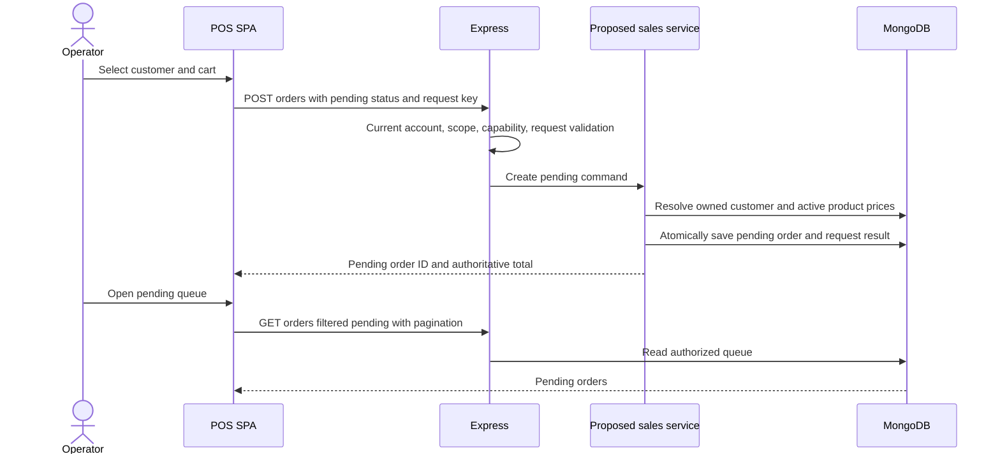
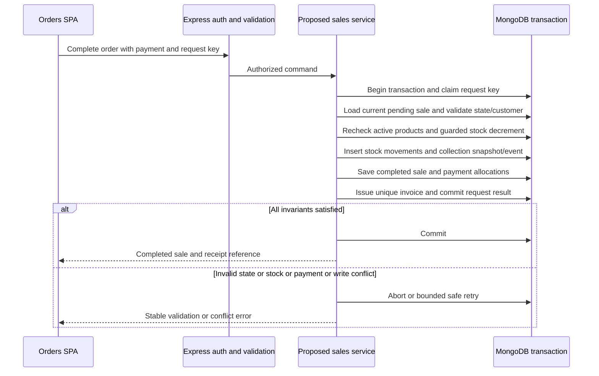

# Data flows and transactional boundaries

Current flows are source-derived, not live walkthroughs. Proposed repairs below are future acceptance behavior. Authoritative storage remains MongoDB.

## Product lookup

Current: ProductPage/PosPage -> useProductApi -> useApi/Axios with bearer JWT -> ProductRoute/protect -> ProductController.getProducts -> owner-filtered Product query -> success envelope -> adapter unwrap -> local rendering/search. POS requests active first200; zero stock disables add. Product prices supplied by the cart are not trusted on creation: backend fetches Product again.

Proposed: bounded literal search, backend pagination/filtering and current-account/capability check. Render unavailable clearly. A stale product shown as available is advisory only; backend rechecks active and conditional stock at completion. Neither lookup nor placing a pending order reserves stock unless a later approved requirement adds reservations.

## Order creation and queue

Current PosPage submits pending, amountPaid and uppercase preview status; backend saves amount on pending but does not create a collection. UI says Sale submitted although stock/financial completion occurs later in OrdersPage. That distinction must be explicit. The proposed pending contract records no collection; payment preview can remain client state or a clearly nonfinancial tender proposal. Existing queue is per owner account, manually refreshed, with no claim/device identity/order number or abandoned-order policy.

Kiosk is unconfirmed. If later required, define physical-device authorization, public-safe catalog, request keys, unique human queue number, expiration/cancellation and cashier claim flow first. A kiosk may create pending orders only within its authorized scope; it must not receive a cashier/admin token or directly complete payments. Do not equate this with an online storefront.

## Checkout, payment recording and stock deduction

Current completeTransaction already decrements through stock>=quantity and uses the caller's session for sale/invoice writes. It derives payment and sets ledgerRecorded. Gaps: no full creation request key, no final active recheck for saved pending items, no movement ledger, incomplete retry handling, and collection snapshots/allocations do not form a consistent historical ledger. `amountPaid` excludes change, while tendered cash/change should be separate validated fields if retained. GCash/bank are manually recorded methods, not verified external settlement.

A concurrent sale for the last unit must result in one successful decrement; other attempts return conflict or retry to an insufficiency result. All other records of an aborted checkout remain absent. This requires real replica-set tests, not a Promise-only simulation. Pending orders can outnumber stock because they currently reserve nothing.

## Debt collection

Current customer-wide payment selects completed outstanding nonvoid sales oldest first, changes amounts and saves one DebtPayment with no transaction allocations. Linked payment changes Transaction in controller and again in model hook: demonstrated double application. `/orders/:id/pay` also passes the order ID as a customer ID.

Proposed: API validates and passes explicit customer/transaction IDs to payment service -> claim idempotency key -> load eligible balances and validate total -> create one collection event -> allocate exactly once per transaction -> update balances and invoice status -> persist audit event/result -> commit. Report periods use collection paidAt, not old sale createdAt. Overpayment or ownership/state conflict aborts the entire operation. Replay returns the original collection without another balance delta.

## Cancellation, void and returns

Current DELETE order aliases void. Pending cancellation sets void fields without restoring stock because ledgerRecorded=false. Completed void restores item stock and marks sale/invoice void in a session; it does not record a refund or reverse a collection. Independent invoice void can diverge from sale.

Proposed state table:

| From | Command | Expected stored effects |
| --- | --- | --- |
| pending | edit | Revalidated draft, no collection/stock movement |
| pending | complete | One conditional stock deduction, financial completion and invoice |
| pending | cancel/void | Void reason/actor/time; no stock increase or financial receipt |
| completed | edit cart | Reject; completed snapshot immutable |
| completed | repeat completion | Replay existing result; no duplicate effects |
| completed | void | Only approved policy; one stock reversal and linked invoice/payment/audit effects |
| void | complete/edit | Reject; do not resurrect a voided sale |

Paid-sale reversal cannot be represented honestly as only hiding revenue and adding stock. Until refund policy is specified and implemented, reject unsupported paid reversals or restrict to an explicitly approved correction process. Returns/refunds are not implemented or confirmed requirements. If required, specify original-line eligibility, quantities, reason/authorization, stock disposition, actual money reversal and reconciliation before adding entities/endpoints.

## Invoice and receipt

Current sale completion -> invoice counter increment -> Invoice linked to Transaction; GET ensure can also issue without state guard. Invoice list populates transaction, while ensure does not. Receipt renderer expects absent top-level items/total.

Proposed: service-issued invoice in sale transaction -> read-only receipt DTO with issue-time snapshots -> browser preview/print -> no mutation on reprint. Store product/customer identity and totals at issue so later edits cannot rewrite historical receipts. Printer format and invoice due date/numbering must be agreed; no tax-compliance claim is made.

## Inventory adjustment

Current API reads Product.stock, adds/clamps delta and saves; active product form also overwrites stock. Proposed authorized adjustment command -> atomic guarded change -> StockMovement with signed delta, reason, actor and request key -> commit. Opening stock is a reconciled baseline. Stock reconciliation is opening+movements=on-hand; do not infer full history from present stock.

## Financial reports

Current dashboard -> FinancialController -> completed/nonvoid transactions -> sum current amountPaid and balance, group by createdAt -> client formats centavos. Expense data is separate. A debt collected later changes an earlier sale bucket. No full accounting flow exists.

Proposed separate reads: sales use completedAt and immutable total; collections use actual initial/subsequent payment events at paidAt; outstanding uses reconciled allocations/balance as of a defined cutoff; expenses use the same centavo/date policy. Apply approved timezone boundaries before aggregation. Costs, taxes, refunds and adjustments require explicit scope and formulas before any profit statement. Report service is read-only; financial errors are corrected by audited events, not silent recalculation of source history.
