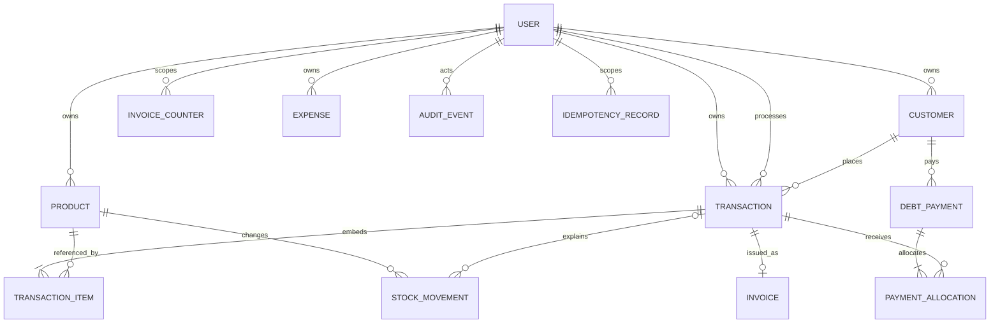

# Database architecture and relationship plan

Current persistence: MongoDB via Mongoose9.3.3. No SQL implementation, migration runner or seed-based schema management is configured. All documents have implicit ObjectId `_id`; Mongoose refs are not database foreign keys. Runtime server version, topology, actual indexes, dataset size and existing record formats are unverified.

## Existing entities

| File / registered model | Fields and validation | Declared indexes / relationships |
| --- | --- | --- |
| `models/User.js` / User | Required identifier/password; role user/admin; confirmed=false; optional name/phone/address; timestamps | Unique identifier; unique sparse phone (explicit null from controller can still collide); no password hooks/method |
| Product | Required owner/name/price; stock0, costPrice0, min0 on amounts/stock; sku empty default, category General, isActive=true; timestamps | owner, isActive; owner+name, owner+sku, owner+category+isActive; no unique SKU; owner -> User |
| `Person.js` / Customer | Required owner/name; optional phone/email/address default empty; soft-delete fields; timestamps | owner, isDeleted; owner+name, owner+phone; refs User |
| `Order.js` / Transaction | Required owner/customer/totalAmount; embedded product/quantity/unitPrice/subtotal; quantity min1; monetary min0; paid/balance; payment and order statuses, methods/reference/type; completedAt, processedBy, void fields, notes, createdAt/updatedAt | owner/customer/paymentStatus/orderStatus/ledgerRecorded/createdAt; owner+customer+createdAt+paymentStatus; owner+createdAt; refs User/Customer/Product; embedded items have no `_id` |
| Invoice | Required owner/customer/transaction/invoiceNumber; issuedAt, dueDate, unpaid/partial/paid/void, notes; timestamps | owner/customer/transaction/status/issuedAt; owner+invoiceNumber and owner+transaction are **not unique** |
| InvoiceCounter | Required owner/type/year; seq0 | owner+type+year **not unique**; User owner |
| DebtPayment | Required owner/customer/amountPaid min1; optional transaction, method/reference/paidAt/notes; timestamps | owner/customer/transaction/paidAt; owner+customer+paidAt, owner+transaction+paidAt; save hook mutates Transaction |
| Expense | Required userId/itemName/amount; category inventory/rent/utilities/salary/misc; date, note, optional createdBy | No additional declared indexes; User refs; no amount minimum or timestamps |
| Financial | Required userId; mutable capital/gross/net; embedded expense type/amount/date, notes; timestamps | No additional indexes; no active route uses this model |

Virtual aliases preserve old clients: Product sellingPrice/quantity/active/userId; Customer contactInfo/userId/summary totals; Transaction products/total/date/personId/userId and item productId/price; Invoice orderId/userId; payment personId/userId. These are representations, not separate stored entities. Some obsolete helpers still expect embedded customer.debts that no longer exists.

## Existing transaction boundaries and integrity risks

Checkout creates customer if needed, validates/reprices items from Product, creates Transaction, conditionally decrements stock, completes sale and creates Invoice/Counter in a session. Update/complete and void likewise use transactions. Debt collection uses a session but applies a linked amount in both controller and model (F05). Customer-wide collection updates multiple sales but records only one unallocated payment. Manual stock adjustment, product update, active-set replacement, customer delete check and invoice ensure are outside atomic multi-record operations.

Guarded stock decrement is a strength: `{stock:{$gte:quantity}}` plus `$inc`. It does not prove conflict retry, duplicate POST safety or resilience against a simultaneous absolute stock edit. Invoice uniqueness is not enforced by schema declarations. No production index query was made, so missing declaration is not proof an administrator never installed an index.

## Proposed core entities and additions

Retain User, Product, Customer, Transaction with embedded lines, Invoice, InvoiceCounter, DebtPayment and Expense. Retain the Financial model file during remediation but do not expose its unused mutable totals as accounting truth. Avoid separate OrderItem/category/payment-method/discount/customer-role tables without need.

Add these **proposed** records because existing operations require traceability:

- **PaymentAllocation:** owner, debtPayment, transaction, integer amount; each collection maps to one or more actual sales. Unique payment+transaction, amounts sum to collection. Initial checkout consideration can remain a sale payment snapshot initially; an immutable initial-collection event is required before date-based collection reporting is certified.
- **StockMovement:** owner, product, signed integer quantity, kind opening/sale/void/adjustment, actor, reason, transaction/request reference, createdAt. Changes persist with stock in the same transaction. Opening movements come from reconciled baseline stock, not inferred old history.
- **AuditEvent:** owner, actor, action, target ID/type, reason, request/correlation ID, timestamp and redacted changes. Required for sensitive existing stock/price/account/payment/void operations; no credentials or tokens.
- **IdempotencyRecord:** owner, operation, key, request hash, committed response/result references and state/time. Unique owner+operation+key. Commit with effect; key lifetime/replay policy must not permit duplicate financial effects after expiration. An embedded per-domain unique request key can replace this collection if it meets the same atomic guarantees.

Propose transaction item name/SKU/unitPrice snapshots and, only when margin reporting is confirmed, cost snapshot. Invoice captures immutable issued store/customer/item/totals representation or references immutable sale snapshots; reprint must not use today's product price or account name. Add integer validation without assuming existing records already have correct units.

## Proposed relationship diagram

Transaction item is embedded, not a proposed MongoDB collection. Diagram optional invoice edge reflects pending transactions; enforce exactly one per issued/completed sale according to approved policy. `processedBy` is an actor reference separate from owner even if they currently match. Store, membership, cashier shifts, suppliers, purchases, returns and discounts are excluded until R01/R02/R08 require them. A shared-store decision replaces owner/account scoping through a separately reviewed migration; do not simply let users choose arbitrary owner IDs.

## Validation and invariants

1. All references exist and belong to the authorized owner/store; actor comes from auth. Reject cross-owner input even when ObjectId is valid.
2. PHP values use nonnegative safe integer centavos, quantities positive bounded integers, stock a nonnegative integer. Signed adjustments are nonzero integers, not clamped. Bounds must keep every multiplication and total within safe integer range.
3. Compute subtotal=quantity*unitPrice and total=sum(subtotals) from authoritative product/snapshot data. Never accept client totals or a supplied subtotal as truth. `0 <= amountPaid <= total`; balance=total-paid; only valid derived payment status.
4. Pending->completed and pending->void are explicit transitions. Completed->void follows approved reversal policy; void cannot reopen. Completed items/prices immutable. Re-completion/replay has no second deduction.
5. Each recorded collection has one allocation per affected transaction, and sum allocations=amount; balances decrease exactly once. Reject overpay atomically. Do not use credit as proof of actual collection without a defined rule.
6. Products inactive at completion cannot be sold. A pending order is not a reservation under current rules; revalidate availability at completion. Define whether pending snapshots honor old prices.
7. Unique invoice per transaction and unique number per owner; unique counter per owner/type/year. Number uniqueness is global only if business policy requires it.
8. Expense create/update obey identical positive integer and enum/date requirements; retain actor/time/revision or reversal traceability for financial changes.

## Index plan

| Collection | Proposed key | Reason / condition |
| --- | --- | --- |
| invoices | unique owner+invoiceNumber; unique owner+transaction | Prevent duplicate issue; analyze duplicates before build |
| invoicecounters | unique owner+type+year | Race-safe counter identity |
| transactions | owner+orderStatus+createdAt; owner+customer+orderStatus+createdAt | Queue, sales/customer history; explain actual queries before adding |
| products | retain existing owner/name/category keys; unique nonempty owner+sku only if approved | Literal lookup and optional SKU policy; empty SKU needs partial filter |
| debtpayments | retain owner/customer/paidAt; owner+paidAt for collections | Collection-date reports |
| paymentallocations | unique debtPayment+transaction; owner+transaction | Allocation reconciliation |
| stockmovements | owner+product+createdAt; request/source-effect uniqueness | Trace inventory and avoid duplicate effects |
| expenses | userId+date (or approved canonical owner+date after migration) | Date filters; no blind rename |
| auditevents | owner+createdAt and target/time as needed | Durable operational/security trace |
| idempotencyrecords | unique owner+operation+key | Serialize request retries; retention requires replay design |

User phone optionality needs normalization: sparse unique indexes skip missing fields, not all explicit-null duplicates. Choose missing versus null consistently and validate uniqueness before changing indexes. Avoid redundant speculative indexes; measure query plans and writes on representative safe fixtures.

## Migration and recovery plan

No schema/index change was applied. First take a protected backup and restore a copy to a nonproduction transaction-capable DB. Inventory actual record fields, credential formats, currency units, duplicate invoices/counters, stock values, orphaned references and ledger/status inconsistencies using redacted counts. Reconcile them through reviewed mappings; ambiguous financial units/history need business decisions, not automatic guesses.

Write versioned, idempotent, dry-run migration scripts with counts, checksums, preconditions and checkpoints. Prefer expand/backfill/validate/switch before removing compatibility aliases. Add allocations/opening stock records only from provable data; mark old unallocated collections as legacy rather than fabricate history. Quarantine unresolved duplicates, do not delete issued financial documents. Build unique indexes only after clean validation and a write-management plan. Rehearse rollback with matched app/schema versions and preserve any new valid transactions during recovery.

Configure encrypted restricted backups, retention and point-in-time recovery if required by approved RPO/RTO; test restore and reconcile stock, sales, collections, allocations and invoice uniqueness. Alert on failure/staleness. No backup or restore exists in the inspected repository and no production backup was assumed. Transaction requirements follow [MongoDB guidance](https://www.mongodb.com/docs/manual/core/transactions/); supported Mongoose9 hook semantics follow the [migration guide](https://mongoosejs.com/docs/migrating_to_9.html).
