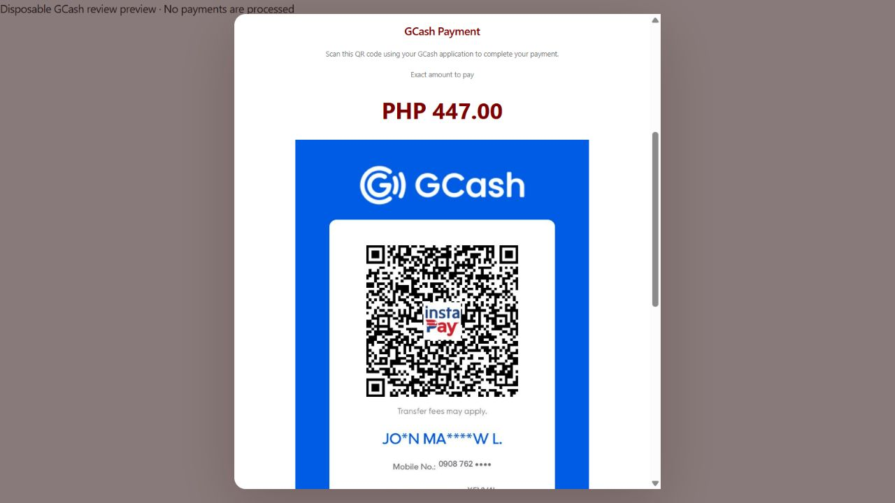
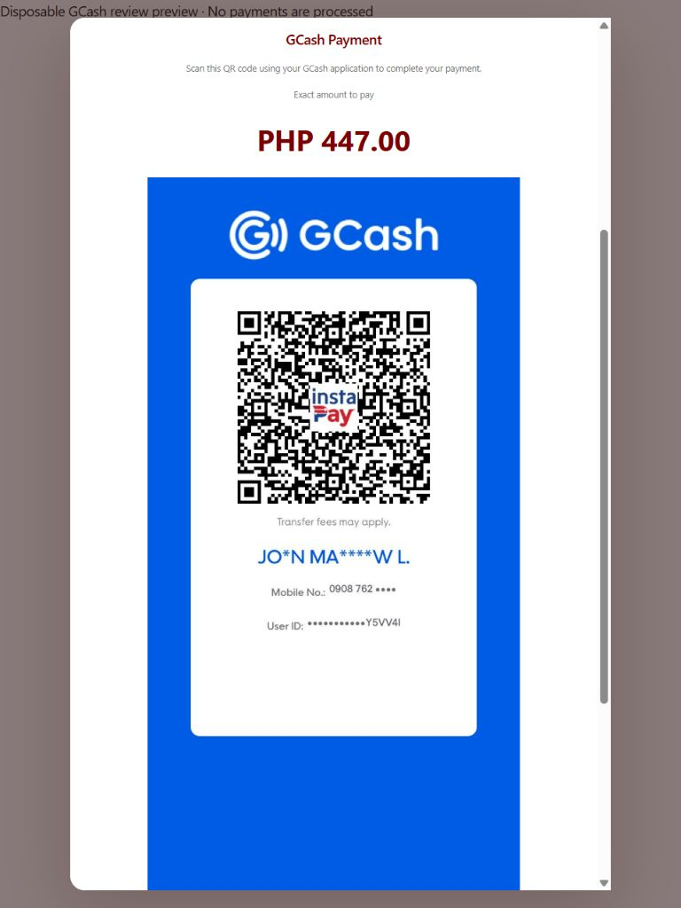
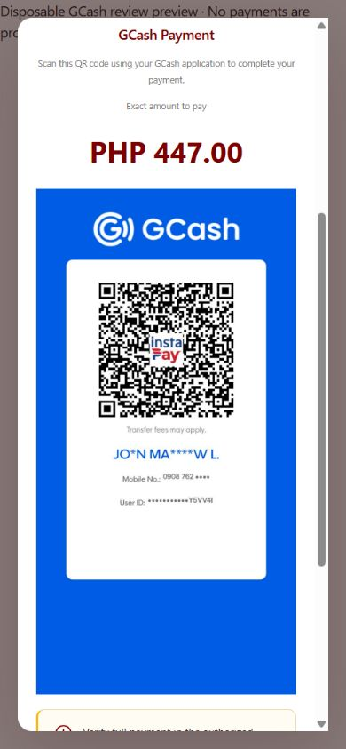

# GCash QR integration — 9 November 2026

## Later display-crop update

At the user's subsequent request, PaymentReview now shows only the QR square and its white scanning margin, matching the supplied cropped reference. A responsive CSS viewport selects the 488 × 488 area at (170, 268) in the original image, displaying it at up to 320 × 320 CSS pixels. The original JPEG and QR pattern remain unchanged. Payment reference, amount and confirmation behavior are unchanged.

Validation: all 16 payment-review/checkout tests, production build and PaymentReview lint passed. Browser inspection confirmed the full QR pattern remains visible; the square fits a 390-pixel mobile viewport at approximately 293.2 × 293.2 pixels. The earlier full-poster screenshots and dimensions below record the initial implementation before this requested crop.

## Files changed

| File | Purpose |
| --- | --- |
| `client/src/features/bookstore/PaymentReview.jsx` | Displays the provided QR image, scan instruction and exact quoted amount only for GCash. |
| `client/public/gcash-payment-qr.jpg` | Original supplied image copied without modification, using the browser-compatible `.jpg` extension. |
| `client/tests/directCheckout.test.js` | Added asset identity, GCash rendering, method switching and consent-reset checks. Existing payment verification and cashier checkout tests remain in place. |
| `client/tests/gcashReviewFixture.jsx` | Disposable browser preview of the actual PaymentReview component with a synthetic PHP 447.00 quote and no API/payment processing. |
| `client/tests/gcashReviewBrowserFixture.mjs` | Explicitly activated local preview server for responsive browser checks. |

This directory contains the successful full client test log and desktop/tablet/mobile browser screenshots.

## Asset preservation

Source: `C:/Users/jmley/Downloads/download (6).jfif`.

Project asset: `client/public/gcash-payment-qr.jpg`, served as `/gcash-payment-qr.jpg`.

The supplied file was already a JPEG. It was copied byte for byte; no image generation, cropping, re-encoding, stretching, recoloring or effects were applied. The entire original image, including the surrounding GCash artwork and whitespace, is displayed. Natural dimensions remain **828 × 1608 pixels**, size **95,637 bytes**.

The source, project asset and production build copy share SHA-256:

`144fae4026c83ce96a1541f4f3421fa679cc9145b5c9bc49ccf3e0af3e66f050`

## Display and payment behavior

The existing `method === "gcash"` branch now contains a centered GCash Payment section, the instruction “Scan this QR code using your GCash application to complete your payment.”, the exact amount from the existing server quote, and the full supplied image. The image uses full available width up to 420 CSS pixels, automatic height and `object-contain`. The existing review modal provides vertical scrolling for the uncropped portrait image and payment controls.

The unavailable-QR sentence was removed. The authorized-account verification reminder and “A screenshot is not payment confirmation” remain. The existing payment reference field, confirmation checkbox, revised-price consent, uncertain-operation blocking and Complete sale validation were retained. Displaying the QR never marks an order paid. No automatic GCash verification, screenshot upload, payment API call or new backend integration was added.

Switching to Cash hides the QR and GCash reference field. Switching methods clears the previous reference and payment consent, as before. Switching back displays the same asset and requires fresh verification. Cash payment handling and order calculations remain unchanged. Only Cash and GCash were already supported by this review; no other payment method was added or removed.

## Verification

| Check | Result |
| --- | --- |
| GCash selection displays QR | PASS — component tests and actual browser preview. |
| Correct provided asset | PASS — original/project/build SHA-256 equality; browser loaded the original 828 × 1608 JPEG. |
| Scan using the GCash application | **NOT VERIFIED** — no physical device running GCash was available. File identity and responsive display are verified; successful recognition/payment in GCash is not claimed. |
| Exact order amount | PASS — existing quote values format unchanged; browser displayed PHP 447.00 prominently in the GCash section. |
| Reference entry and confirmation | PASS — browser and handler tests exercised entry, checkbox state and consent invalidation. |
| Incomplete details block completion | PASS — blank reference or missing confirmation prevents Complete sale; both valid fields enable the existing action. |
| Cash / GCash / Cash switching | PASS — QR visibility follows method selection, consent/reference reset and confirmed Cash remains functional. |
| Existing checkout and price checks | PASS — full client suite includes Cash/GCash checkout, recorded receipts, changed-price consent and uncertain-operation checks. |
| Desktop layout | PASS — default 1280 × 720 preview; image rendered 420 × 815.65 CSS pixels with its original proportions, centered in the existing scrollable modal. |
| Tablet layout | PASS — 768 × 1024 viewport; 420 × 815.65 image, no horizontal overflow. |
| Mobile layout | PASS — 390 × 844 viewport; approximately 293.2 × 569.4 image, no horizontal overflow or aspect-ratio distortion. |
| Production asset | PASS — build copied the original JPEG unchanged. |

- `npm test`: **87 passed, 0 failed**.
- `npm run build`: **PASS**, with the existing large-bundle advisory.
- `npx eslint src/features/bookstore/PaymentReview.jsx`: **PASS**.
- Payment review/checkout tests: **16 passed**, included in the full client suite.

Browser checks used only the disposable preview. No actual orders, transaction records, accounts or payments were created or changed. No sale-completion action was dispatched to a backend. The preview server was stopped and the temporary responsive viewport override reset after testing.

## Scope

Production changes are limited to PaymentReview and its provided static image asset. Backend payment/transaction architecture, database records, calculations, permissions, Admin dashboard, products, inventory, accounting/reports, Kiosk/Guest and unrelated cashier workflows were not modified. No dependencies, schemas or environment settings were added. Existing work from earlier tasks was preserved.

## Browser evidence

