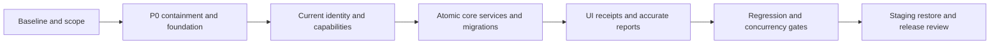

# Implementation roadmap

This is a plan, not a completion claim. No fixed dates are estimated. Priority is risk-driven; complexity is relative Low/Medium/High, not a delivery duration. Independent project: LadyPos/ServeFlow POS. Keep the existing stack and source layout.

## Phase 1 — Discovery, baseline and scope

- **Objective:** establish a trustworthy starting state and resolve choices that change architecture.
- **Tasks:** review this audit; preserve existing lockfile changes; capture clean fixture-based behavior; decide R01 ownership, R04 pending flow, R05 credit/walk-in, R06 money and R10 provisioning/session policy; classify remaining conditional requirements. Record data/credential/index inventory against a protected restored copy when available. Define accepted test topology and service/recovery targets.
- **Dependencies:** repository and authorized nonproduction data access; business decision record.
- **Deliverables:** reviewed requirements/role matrix, source baseline, redacted migration assessment, executable failing regressions for reproduced defects.
- **Acceptance:** proposed features are separated from committed scope; critical findings have reproducible tests; no test can accidentally load production connection settings; existing user changes preserved.
- **Risks:** no primary specification; production data may have mixed units/password formats; shared-store assumption could force wrong migration.
- **Priority/complexity:** P0/P1, Medium.

This audit completes repository discovery and documentation only. It does not complete live data inventory, requirements decisions or the future regression suite. Containment below proceeds immediately alongside decisions that do not affect the fixes.

## Phase 2 — Critical containment and foundation

- **Objective:** remove obvious privilege/credential exposure and stop incorrect financial mutation.
- **Tasks:** fix F01 public account provisioning; implement shared hash/compare path F02; remove/redact public logs and URI emission F03; plan controlled secret rotation/untracking; remove second payment application and callback misuse F05. Define canonical IDs, safe errors, centavo DTOs and testable app construction. Add safe package-local examples and validated startup configuration in focused changes.
- **Dependencies:** Phase1 baseline; approved administrator provisioning approach; protected operations access for secret rotation. Payment fixes must include real rollback tests before release.
- **Deliverables:** focused remediation patches and regressions; no public log stream; controlled credential reset/rotation plan; service/error/identity contracts.
- **Acceptance:** anonymous/admin escalation denied; password writes are hashes; unconfirmed tokens rejected; secret output absent; payment100 changes paid by100 exactly; failures do not leave partial records. Critical exposed credential remediation is verified separately from code removal.
- **Risks:** mixed password hashes, deployed secrets remaining valid, legacy payment records already inconsistent, accidental double hashing or unapproved history rewrite.
- **Priority/complexity:** P0, High.

## Phase 3 — Authentication, account state and authorization

- **Objective:** make current account and scope/capability checks authoritative.
- **Tasks:** canonical user.id throughout, correct profile/password and self-delete/last-admin checks F04; current-account/session invalidation F13; enforce approved sensitive-operation capabilities F22; repair frontend auth setter/storage/401 recovery; forward account search/paging; replace fixed-password seed F20 with controlled provisioning. Define deactivation versus hard deletion.
- **Dependencies:** account/password foundation and R01/R10 policy; conditional Store/membership design only if shared cashiers confirmed.
- **Deliverables:** implemented account/session policy, backend capability matrix and allow/deny tests, usable profile/admin UI.
- **Acceptance:** cross-owner IDs denied, privileged operations denied to unauthorized users, old token rejected after status/role/password changes per policy, profile edit survives reload, self/last-admin guards server-enforced.
- **Risks:** changing JWT identity or policy invalidates sessions; owner/account conflation; UI permission visibility diverging from backend.
- **Priority/complexity:** P1, High.

## Phase 4 — Transaction, inventory, payment and invoice integrity

- **Objective:** guarantee supported money and stock operations are atomic, consistent and retry-safe.
- **Tasks:** service extraction without request delegation; fix settlement F06; validated state/customer/active checks F10; request keys F11; atomic stock adjustments, no metadata stock overwrite, StockMovement F09; single payment application/allocations; fix numeric rules F08; reconcile and add reviewed unique invoice/counter indexes F07; ensure POST issue/read-only GET and stable receipt DTO F12. Add versioned dry-run migrations before changing data/indexes. Shared-store and kiosk work remains conditional.
- **Dependencies:** approved money/ownership/void policies, transaction-capable MongoDB fixtures, historical duplicate/unit inventory, authorization foundation.
- **Deliverables:** sale/payment/inventory/invoice services; allocation/movement/idempotency records as selected; migration scripts and rehearsals; core API contract and integration coverage.
- **Acceptance:** last-unit race allows one sale; failure rolls back all effects; network replay duplicates nothing; collection allocations reconcile; full settlement works; duplicate invoice issue yields one document; inactive product not sold; metadata edits preserve inventory; corrected receipts reflect immutable amounts.
- **Risks:** index creation on duplicate records, unknown historical units, ambiguous commit responses, unsupported paid void semantics and retroactive receipt changes.
- **Priority/complexity:** P1 (F05 containment remains P0), High.

## Phase 5 — Supported UI, reporting and operational traceability

- **Objective:** make confirmed workflows usable and accurately described.
- **Tasks:** align POS pending/complete language and tender/status handling; implement pagination/search beyond first pages F16; repair invoice filter/view/print; accessible recoverable errors; consistent expense money/validation/history; dated sales/collections reports F17; durable redacted audit events; retire unreachable legacy callers/components only after review. Full accounting, discounts, refunds, receiving and kiosk require approved scope first.
- **Dependencies:** stable core DTOs/invariants; reporting basis, timezone, print/numbering decisions; audit retention policy.
- **Deliverables:** tested active pages, receipt output, explicit report definitions, reconciled customer/payment summaries and traceable sensitive actions.
- **Acceptance:** user can find records beyond initial limits, complete/settle/reprint through active UI, see accurate date-specific sales/collections, recover from rejected payment/stock errors; no unsupported accounting/integration claim.
- **Risks:** truncated legacy data, report comparisons mixing collection and sale dates, browser/receipt differences and hidden obsolete paths.
- **Priority/complexity:** P1/P2, High.

## Phase 6 — Stabilization and independent verification

- **Objective:** prove release invariants and regression quality rather than rely on UI presence.
- **Tasks:** run unit/API/real-replica-set/component/E2E/security/concurrency suites; repair18 lint errors/13 warnings; production build; advisory scan from working network; representative performance and recovery tests; verify config/secret redaction, migration rollback and graceful shutdown. Measure bundle/device behavior after correctness fixes.
- **Dependencies:** Phases2-5 behavior complete; isolated repeatable fixtures and agreed performance/concurrency thresholds.
- **Deliverables:** reproducible pass/fail reports, lockfile/advisory review, reconciliation evidence, release candidate and documented residual risks.
- **Acceptance:** all required scenarios in testing-strategy pass, lint/build pass, no unresolved P0, P1 release blockers resolved or formally scoped out with evidence, no financial reconciliation discrepancy; repeated concurrency/ambiguous-response tests stable.
- **Risks:** mocked tests masking DB topology behavior, flaky browser tests, unsupported dependencies, unreachable advisory service.
- **Priority/complexity:** P1, High.

## Phase 7 — Staging and production-readiness gate

- **Objective:** prove deployability/recovery before a separately authorized release.
- **Tasks:** configure selected static/API hosts, TLS/PORT/CORS and least-privilege DB; run reviewed migrations in staging; health/monitoring alerts; backup/restore drill; smoke flow; matched-version rollback rehearsal; operational ownership and runbook. Deploy production only through a later explicit release action, outside this audit.
- **Dependencies:** Phase6 evidence, approved target/recovery policies, operator credentials/secrets managed outside source control.
- **Deliverables:** staging validation, environment manifest without values, backup and rollback evidence, signed-off readiness checklist/runbook.
- **Acceptance:** staging boot/config/deep links/auth/checkout/payment/receipt/reporting pass; restore matches agreed RPO/RTO and reconciles data; shutdown does not lose committed transactions; monitoring actionable; release blocked for incomplete mandatory checks.
- **Risks:** live schema/data divergence, incompatible rollback, secret leakage in hosting settings/logs, stateless API host with unavailable DB.
- **Priority/complexity:** P1, High.

## Dependency order

Security containment must not wait for optional feature decisions. Shared stores, kiosks or accounting are separate conditional work packages, not dependencies for repairing the existing implementation.

## Current UI redesign record — 2026-11-04

The separately owner-authorized university branding/UI redesign has been implemented in the existing application. See [UPHSD UI redesign results](../UPHSD_BOOKSTORE_UI_REDESIGN_RESULTS.md) for the shared design system, four role interfaces, real API integrations, screenshots, file inventory and verification limits.

Local checks: frontend32/32, backend812/812, five guarded synthetic API smoke groups, current role UI lint and production build pass. Full inherited lint remains13errors/12warnings and the bundle-size warning remains. Backend117/117first-party files are unchanged. No database/schema/migration/production/deployment action occurred. AR01 cancellation remains disabled in the UI pending its separately tracked backend correction; this does not close AR01 or the activation-audit blockers.

All earlier phases and B01/B02/B03 completion/review history remain preserved. UI completion is not release approval, native database proof or authorization to start another phase.

