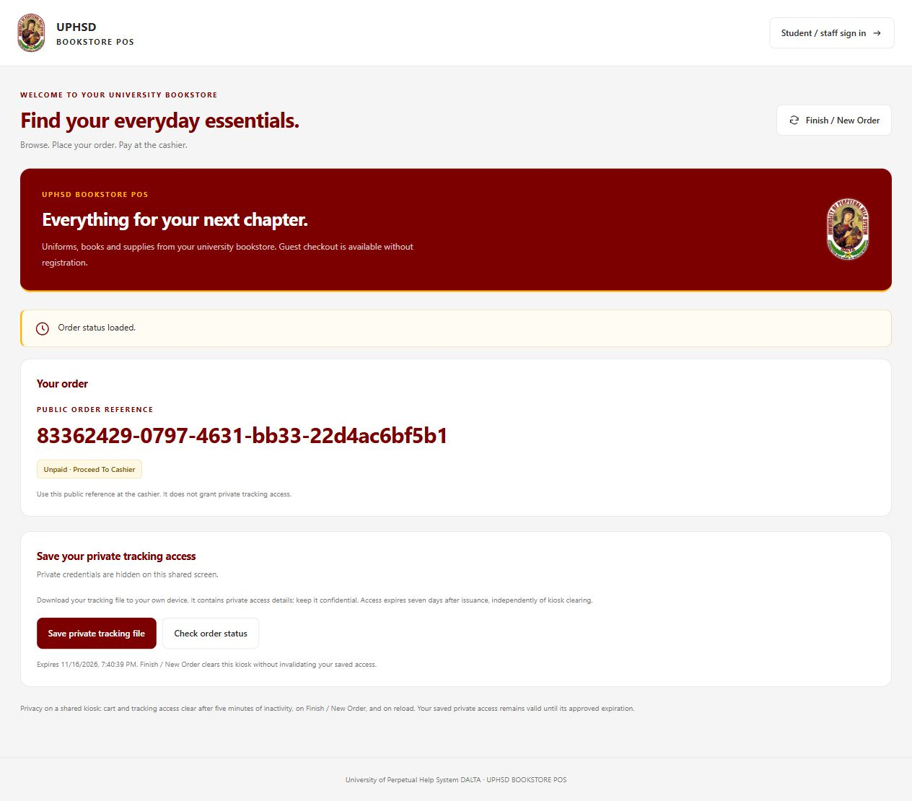

# Kiosk/Guest ordering fix — 9 November 2026

## Root cause and evidence

The local `backend/.env` assigned the literal instruction `Operational audit → store.created → Target.` to `BOOKSTORE_PUBLIC_STORE_ID`. The guest-only guard requires an explicit 24-character hexadecimal store ID and positive integer rate settings. It therefore returned HTTP 503 before catalog lookup, intent issuance or order submission. Global authentication, guest inactivity expiration and inventory writes were not the source of this initial failure.

The kiosk mapped every 503 to “Ordering is temporarily unavailable” and fetched the catalog only on mount. Its only recovery instruction was a reload, which deliberately clears kiosk state. A separate recovery gap blocked further submission after a lost order response, even when a same-operation replay was safe.

A read-only database check found one existing `UPHSD Bookstore` (`6aeee8b846436bb2e389465a`) with an existing owner, compatibility customer and five active centavo catalog products. The guest environment setting now names that verified store. The rate limit remains 100 requests per 60,000 milliseconds. No credentials, other environment settings, account records or database records were changed.

After correction, the actual guest guard admitted the request and `guestCatalog` loaded five products, four available. This verification disabled Mongoose automatic collection creation and indexing and performed reads only. `VITE_API_URL=/api` matches the existing development proxy; no API URL change was needed.

## Files modified by this task

| File | Change |
| --- | --- |
| `backend/.env` | Replaced only the invalid guest public store ID with the verified existing ID. |
| `backend/middleware/guestBookstore.js` | Added a safe configuration error code and rate-limit Retry-After header; retained explicit activation, credential rejection and request limits. |
| `client/src/features/kiosk/guestApi.js` | Added a 15-second request timeout, safe network/non-JSON/malformed-envelope handling, and distinct setup/throttling/transient messages. |
| `client/src/features/kiosk/guestCheckout.js` | Added a kiosk-memory submission controller that retains original intent, credential, operation ID and payload for uncertain retries. |
| `client/src/features/kiosk/KioskPage.jsx` | Added catalog retry without reload, wired safe submission replay, validated confirmation/status replies and read fresh cart state when decrementing quantities. |
| `client/tests/guestApi.test.js` | Added transport, error response, timeout, abort and credential-isolation tests. |
| `client/tests/guestCheckout.test.js` | Added quantity/size submission, expiry recovery, replay identity, throttled replay and stale response privacy tests. |
| `client/tests/guestPage.test.js` | Added tests of actual kiosk handlers with deterministic hooks, API replies and clock. |
| `backend/tests/bookstoreApi.test.js` | Added guest configuration reproduction and expired-proof recovery tests; updated the guest limiter response stub for headers. |

This directory also contains the report, full successful test logs and a screenshot from the disposable browser fixture. The checkout had extensive pre-existing modified/untracked work; this task did not overwrite it or change staff implementation files.

## Implementation and security

The configuration correction restores catalog access without guessing a store or weakening activation validation. A configuration-specific machine code survives the existing shared 5xx message sanitization, so kiosk users receive an actionable setup error. Shared response sanitization was not changed.

Catalog retry preserves current kiosk memory. Orders are not automatically replayed. After an uncertain order response, an explicit retry sends the original body and credential through the existing backend receipt/idempotency checks. A later rejected or throttled replay cannot establish whether the original committed, so uncertainty and the same submission identity remain until a successful confirmation/tracking result or explicit session cleanup. A definitive first-attempt credential rejection permits new guest intent initialization on the next explicit submission. Tracking errors never grant access or silently initialize a different order.

Existing backend guest order creation, transactions, inventory pricing, audit, receipts, seven-day credential verification and protected route registration were reused unchanged. Guest requests still omit cookies and staff Authorization headers. The backend still rejects Authorization on guest routes. Private credentials remain memory-only and are sent only in the private request header, never URL parameters.

The original session manager and credential verifier were not changed. Cart, proof, confirmation and pending replay clear at five minutes of inactivity, Finish / New Order, pagehide/reload and unmount. Late network responses cannot repopulate a cleared generation. These client resets do not revoke saved private access or delete/cancel server orders. Saved credentials retain their original seven-day expiration.

## Validation results

| Requirement | Result and evidence |
| --- | --- |
| Open ordering page and initialize guest session | PASS — actual browser fixture and page-handler tests; backend HTTP intent issuance tests. |
| Load products and inventory availability | PASS — browser fixture plus actual configured database read: five products, four available. |
| Add items and edit quantities | PASS — browser add/increase/decrease; page-handler and checkout payload assertions. |
| Product size selections | PASS — guest checkout payload and existing clothing selection tests; shared backend pricing/size validation coverage in the full suite. |
| Checkout, submit and confirmation | PASS — actual browser against in-memory backend fixture; backend HTTP tests verify pending order persistence and replay without stock/payment effects. |
| Private tracking | PASS — browser status loaded; backend proof binding, wrong-proof rejection and staff endpoint denial. |
| Temporary network/API failures | PASS — catalog retry handler, lost response replay, 429/503 replay, non-JSON proxy responses, timeout, cancellation and invalid envelopes. |
| Expired or invalid guest access | PASS — backend rejects expired proof; fresh intent succeeds; page handler initializes new proof after definitive denial. |
| Five-minute cleanup | PASS — deterministic exact-boundary session and actual page-handler tests, including pending/late responses and background expiry. No five-minute real-time browser wait was used. |
| Finish / New Order cleanup | PASS — browser and page-handler tests clear cart, confirmation and private tracking controls. |
| Reload behavior | PASS — browser reload clears cart and reloads catalog; page-handler/session tests verify proof is not restored. |
| Saved private access lifetime | PASS — seven-day boundary verifier tests; backend old saved proof remains valid after new intent issuance. |
| Admin login/dashboard access and permissions | PASS — full backend authentication/role/context route matrices and client role-navigation regression suite. |
| Cashier login/POS transactions | PASS — full backend login/payment/receipt tests and client direct checkout tests. |
| Inventory Manager and other permissions | PASS — full backend inventory, catalog and route/role matrices; client manager management tests. |

- `client`: `npm test` — **70 passed, 0 failed** (including 20 guest tests).
- `backend`: `npm test` — **861 passed, 0 failed**.
- `client`: `npm run build` — **PASS**, with the existing large-bundle advisory.
- `client`: `npx eslint src/features/kiosk` — **PASS**.

The initial sandboxed backend run failed because loopback connections were denied (`EACCES`). The complete rerun with loopback access passed; no assertion was bypassed. Backend HTTP and browser ordering used disposable in-memory fixtures and the real application handlers. Native MongoDB transaction commit/failover and live staff browser sessions were not exercised. No live database orders or payments were created for testing.

Admin, Cashier, Inventory Manager, other account roles, shared authentication/session services, permissions, dashboards, accounting, inventory management and cashier workflows were not modified by this task.

## Runtime configuration

Restart an already-running backend to load the corrected `.env`, and rebuild/redeploy the frontend where required to serve the recovery changes. A separately deployed backend must set its own `BOOKSTORE_PUBLIC_STORE_ID` to its verified store ID and retain its approved positive guest rate/window values; the local `.env` does not update hosting-provider settings. No frontend credentials or hardcoded API endpoint were introduced.

