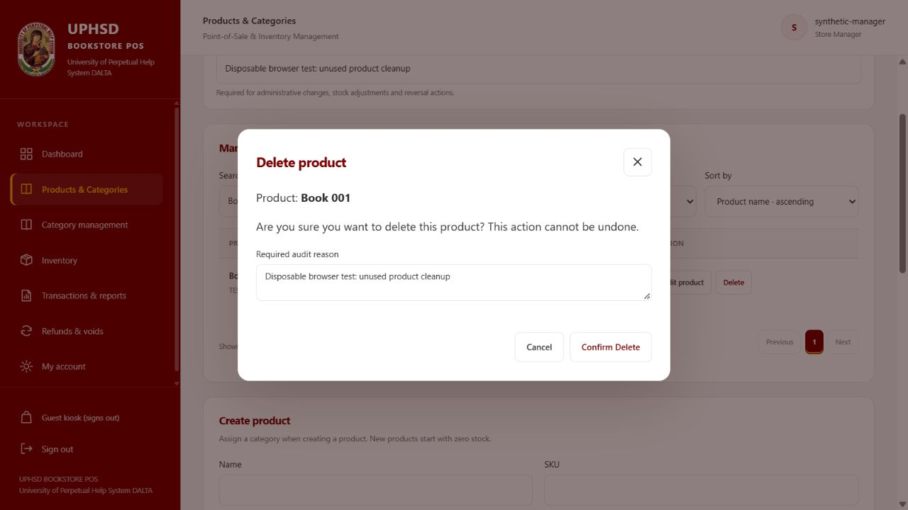
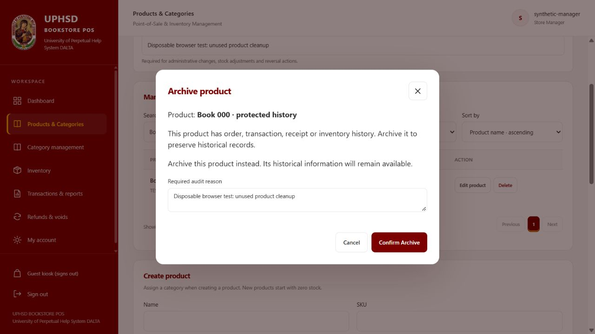

# Manage Products: deletion and pagination

## Implemented behavior

The existing five-column table retains its Product, Category, Price, Availability and Action layout. Compact Edit product and red Delete actions sit together. Delete first opens a named confirmation modal and checks references; it never immediately executes a mutation. An audit reason and a separate Confirm Delete or Confirm Archive action are required. Cancel closes the modal without a mutation. Success and error notices report the outcome.

Manage Products now requests one backend page at a time rather than fetching every product page. Default page size is 10; choices are 10, 20, 50 and 100. Navigation provides Previous, Next, numbered pages, ellipses for large page counts, selected-page styling and an accurate product range/count. Name/SKU search, category, active/inactive filtering and ascending/descending name, price and category sorting all run against the same backend filter. Changing these controls resets to page 1. Deletion refreshes the current query and clamps the page when its last record disappears. Loading, retrieval error/retry and empty-result states are included.

The duplicate all-products card list previously shown below the manager's table is no longer rendered in that view. Cashier/student catalogs retain their existing rendering and loading paths. Product creation and the existing edit form, field permissions and save payloads are preserved. The edit action still refreshes parent data and category options after a successful save.

## Backend and deletion rules

- Existing `GET /api/products` supports the opt-in `management=true` query. It is limited to the existing Store Manager role and existing scoped read middleware. Existing catalog requests retain their previous behavior. Allowed pagination limits and sort fields are validated. Search text is escaped as a literal regular-expression pattern. Count and page queries use the same store/search/category/availability filter, with `_id` as a deterministic sort tie breaker.
- Existing `GET /api/products/:id?management=true&storeId=...` returns deletion eligibility only after the existing product scope check and manager validation. This preflight is informational; deletion rechecks independently.
- Existing `DELETE /api/products/:id` gains an explicit `deletionMode: "permanent"` option for Manage Products. Requests without this option retain the original deactivation behavior. Other roles do not gain permanent-deletion access.
- Permanent deletion runs inside the existing bookstore command transaction, account fence, realm lock, membership/capability checks, audit and idempotency receipt boundary. It requires zero stock and no reference in orders (including pending/cancelled and legacy records), invoice snapshots, inventory movements, sale returns or operation receipt item snapshots. Checks use product identity globally so historical/unmapped references are protected too. Reference-check errors fail the operation; they never authorize deletion.
- Referenced or stocked products offer Archive instead, using the existing deactivation operation. Archive changes availability and retains the product, order items, recorded prices, receipt snapshots, returns and inventory history. Already-archived protected products are identified in the modal.
- Products with unverified historical money units retain the existing reconciliation restriction; both destructive actions remain unavailable until attribution is reviewed.
- Permanent removal retains catalog metadata in the existing audit format (`product.updated`, with `after.deleted: true`). Existing operation receipts make an acknowledged deletion replay idempotent. Audit failure rolls back deletion. No ledger/history record is deleted or rewritten.

No route registrations, role definitions, authorization middleware, database schemas, collections, dependencies, API base URLs or environment settings were changed.

## Files changed in this task

| File | Change |
| --- | --- |
| `backend/services/productManagement.js` | Added opt-in manager listing, reference checks and transactional permanent deletion. |
| `backend/controllers/ProductController.js` | Delegated explicit management listing/preflight/deletion requests; retained ordinary product API behavior. |
| `client/src/features/products/components/ManagerProductsTable.jsx` | Added paginated table controls, named Delete/Archive confirmation, cancellation, notifications and retrieval states. |
| `client/src/features/products/components/ManagerProductManagement.jsx` | Connected the table to the existing edit form and refresh handling; category management remains unchanged. |
| `client/src/features/bookstore/BookstorePage.jsx` | Passed the scoped API to Manage Products, bypassed its eager catalog loading, avoided duplicate product cards, and retained existing parent refresh behavior for edits. Changes are conditional on the manager product view. |
| `backend/tests/productManagement.test.js` | Added 12 service/HTTP tests for deletion, references, archival, rollback, scope, roles, paging/search/filter/sort and unchanged editing/default archive behavior. |
| `backend/tests/productManagementAdapter.js` | Added isolated in-memory query semantics for the product-management test fixtures. |
| `client/tests/managerProductsTable.test.js` | Added six actual-handler tests covering page sizes, navigation, filters, sorting, deletion, cancellation, archival, table refresh, errors and edit dispatch. |
| `client/tests/managerManagement.test.js` | Updated component compilation for the table extraction and retained existing manager/editor assertions. |
| `client/tests/managerProductsBrowserFixture.mjs` | Added an explicitly activated, disposable 125-product browser fixture with synthetic manager credentials and no database connection. |

This directory contains the report, successful full test logs and browser screenshots. The workspace had extensive pre-existing changes, including the earlier kiosk fix; they were preserved.

## Testing and results

| Requested check | Result |
| --- | --- |
| Delete product without transaction history | PASS — HTTP/service tests and browser confirmed deletion of a synthetic unreferenced zero-stock product. |
| Prevent permanent deletion with history | PASS — pending, completed, cancelled and legacy orders, invoice snapshots, movements, returns and operation receipt references reject deletion. |
| Archive protected products | PASS — backend checks retained original history and product metadata; browser offered Archive and changed the protected product to Archived. |
| Cancel confirmation | PASS — handler test recorded no mutation; browser Cancel retained the product. |
| Successful deletion updates table | PASS — browser displayed success and the filtered row disappeared; handler test deleted the last page's only row and clamped back to the previous page. |
| More than 10 products | PASS — 125-product service, component and browser fixtures. |
| 10/20/50/100 products per page | PASS — backend limits/counts, component row counts and browser ranges. |
| Search product name and SKU | PASS — backend/component tests and browser searches for `Book 001` and `TEST-1`. Literal regex metacharacters do not match every product. |
| Category and availability filters | PASS — combined filter/count tests and browser filtering. |
| Sorting | PASS — backend validates all three fields in both directions; component requests and browser price-descending order were verified. |
| Empty search results | PASS — proper empty state and Showing 0–0 of 0 products. |
| Existing Edit Product | PASS — existing editor assertions and callback tests; browser saved the protected product's Active field before archiving. |
| Sales/history remain intact | PASS — backend reference tests compare original historical records after archival; full transaction, report, receipt, inventory and role regression suites passed. |
| Late history/reference race | PASS — reference added after preflight blocks permanent deletion when the transaction rechecks. |
| Audit failure and replay | PASS — failed audit rolls back removal; repeating an acknowledged operation returns the original deletion result without a second audit. |
| Loading/API errors | PASS — UI handler tests cover retrieval retry, reference-check failure and deletion errors without unsafe dispatch. |

- **Backend:** `npm test` — **873 passed, 0 failed**.
- **Client:** `npm test` — **76 passed, 0 failed**.
- **Production build:** `npm run build` — **PASS**, with the existing large-bundle advisory.
- **Changed frontend files:** ESLint — **PASS** for `ManagerProductManagement.jsx`, `ManagerProductsTable.jsx` and `BookstorePage.jsx`.

The first client run encountered sandbox `EPERM` while reading an unchanged source file. The complete rerun outside that access restriction passed without bypassing assertions. Backend HTTP tests and the browser use disposable in-memory fixtures and the real application handlers. Native MongoDB transaction commit/failover was not exercised. No live products, transactions or accounts were modified or deleted during testing. The browser fixture was stopped after verification.

## Scope and runtime

Cashier POS, Kiosk/Guest ordering, Admin dashboard, inventory receiving, accounting/reports, authentication, role permissions and product creation workflows were not changed. Existing product editing fields and permissions were retained. Changes in the shared bookstore page and product controller are restricted to the new Manage Products path; existing consumers are covered by the full regression suites.

No migration or new environment configuration is required. Running deployments need the updated backend and frontend build. Existing unverified legacy monetary units still require the project's existing attribution review.

